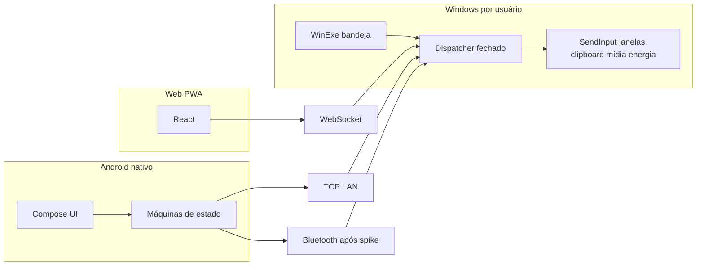

# Plano — reconstrução do controle remoto PCFlow

Data: 2026-11-10.
Base: `7af76ed6606b282dcce56de60fbed472ca699630`.
Estado: plano aprovado para execução futura. Nenhuma feature deste plano foi implementada nesta branch.
Matriz viva: `docs/qa/video-feature-coverage.md`.
Ledger: `docs/engineering/implementation-ledger.md`.

Os headings em inglês abaixo são os exigidos pela seção 15 do prompt mestre.

## Goal

Substituir o núcleo alpha atual por um controle remoto de PC funcional: Android nativo em Compose, agente Windows por usuário, Web/PWA honesta, protocolo versionado compartilhado, LAN e Bluetooth reais, conta/PRO fora do hot path, testes, CI, ameaças e documentação. Cada função da seção 7 termina com implementação real e teste citado na matriz. Código que já funciona é caracterizado e refatorado, não apagado.

Esta branch só entrega preflight, matriz e este plano.

## Architecture

Dois processos de produto e um cliente Web, ligados por um núcleo de comando independente de transporte.



A UI não abre socket nem chama Win32. Descoberta não autentica. `Ready` só existe depois de autenticação e de capabilities. Conta e sync ficam fora do caminho do pointer, do teclado e do clipboard.

O código atual já tem o esboço certo desse corte: `SessaoPcFlow` no Android e `ServidorPcFlow` + `ExecutorComandos` no Windows, com WinExe sem console. O plano extrai esse núcleo para uma biblioteca testável e substitui o JSON informal por contrato versionado, mantendo um adaptador das mensagens `ola`, `mouse_move`, `mouse_click`, `scroll`, `texto`, `tecla`, `media` e `power` até a paridade estar testada.

### Máquinas de estado

Ficam explícitas e testadas, sem combinações soltas de booleanos:

- Conexão: Idle, Discovering, DeviceSelected, Connecting, Authenticating, NegotiatingCapabilities, Ready, Reconnecting, Error(permission, network, auth, version, unsupported). Task T03.
- Modificador: Inactive, ArmedByTap, ActiveHeld, Released. Task T23.
- Botão do pointer: Up, Down, Dragging, Up. Cancel, perda de foco, reconnect e pause voltam a Up e disparam safety release. Task T16.
- Gyro: Disabled, EnabledIdle, Calibrating, Active, Paused, Error(sensor unavailable). Task T44.
- Clipboard: Idle, OfferMetadata, AwaitAccept, Transfer, VerifyHash, Apply, Done, Error. Task T34.

### Rulings que travam a arquitetura

ADR-001 a ADR-019 estão no ledger. Os que mudam desenho de código:

- ADR-001: schema único, JSON por linha, adaptador v1.
- ADR-002: TCP permanece no hot path Android até benchmark; Web usa WebSocket no mesmo dispatcher.
- ADR-003: Bluetooth só depois do spike T48.
- ADR-004: input continua no WinExe por usuário. A frase de `docs/ARCHITECTURE.md` que sugere serviço interativo não será seguida.
- ADR-005: `com.ander.pcflow` / PCFlow. O APK `br.flowtutum` não é fonte.
- ADR-008: energia só com confirmação e política.
- ADR-016, revisto depois da gravação: com a opção ligada, toque envia o modificador sozinho; segurar ativa para a combinação; um segundo acionamento trava. Soltura em queda de sessão continua obrigatória. O toque não arma a tecla seguinte.
- ADR-018: conta e PRO são portas e adaptadores. Banco, backend real e pagamento ficam fora do corte, como dependência externa do dono. Entitlement de dev não existe em produção. O controle local não chama essas portas.
- ADR-019: o Chefinho é um módulo opt-in, depois do slice 14. Cada fonte nasce desligada. O controle remoto não chama esse módulo. O servidor que receberia os dados é dependência externa. Teclado e clipboard continuam de fora.

## Tech stack

| Camada | Escolha | Motivo |
|--------|---------|--------|
| Android | Kotlin, Jetpack Compose, Material 3, ViewModel, StateFlow, Coroutines, DataStore, Navigation Compose | Já é a base do repo, e é a preferência do prompt. Room só se favoritos ou devices precisarem de query e migração. |
| Windows | C# / .NET 8, WinExe WPF + bandeja WinForms | Já compila como `net8.0-windows`. Lógica pura sai para `windows/PCFlow.Core` para teste sem UI. |
| Web | TypeScript, React, Vite, PWA | Não há stack Web no repo. |
| Contrato | JSON Schema em `protocol/schema/pcflow.protocol.json` e fixtures douradas | Um arquivo é a fonte; Kotlin, C# e TypeScript não ganham modelos divergentes. |
| Testes | JUnit no Android, xUnit no Core, Vitest e Playwright na Web | Não há suíte hoje. |
| CI | Workflows separados e um gate de contrato | O `build.yml` atual só compila. |

JDK de referência do README e do CI: 17. O preflight compilou o Android com JDK 21 e `jvmTarget` 17. A CI continua em 17 até alguém medir necessidade de subir.

## Spec paths

| Caminho | Papel |
|---------|--------|
| Prompt mestre anexado à execução | Fonte 1. Não está versionado neste commit. |
| `docs/qa/video-feature-coverage.md` | Fonte operacional das 122 funções da seção 7. Coluna de vídeo preenchida em 2026-11-10. |
| `docs/reference/02_ANALISE_VIDEO_FRAME_A_FRAME.md` | Leitura do corte de 3:34. |
| `docs/reference/analysis_assets/` | Frames e contact sheets. O mp4 não está no git. |
| `docs/ARCHITECTURE.md` | Descreve o alpha. ADR-004 substitui a sugestão de serviço. |
| `docs/ROADMAP.md` | Backlog antigo. Não ordena esta reconstrução. |
| `docs/engineering/implementation-ledger.md` | SHA base, baseline e rulings. |

Quando o vídeo chegar, T00 atualiza a matriz antes do aceite visual. Função nova vista só no vídeo ganha task nova antes de código.

## Global constraints

- Cada slice vertical termina observável: teste RED, implementação mínima real, refactor com suíte verde, revisão, commit pequeno.
- O schema em `protocol/schema/pcflow.protocol.json` tem um dono por vez. Mudança de schema leva fixture Kotlin, C# e TypeScript no mesmo commit.
- Android principal permanece Compose. WebView não é a aplicação.
- O agente que injeta input é processo de usuário na sessão interativa. Sem console na execução normal.
- Descoberta, anúncio mDNS e broadcast UDP não autorizam comando.
- Comandos são um enum fechado. Não existe mensagem de shell, de caminho arbitrário ou de HWND cru vindo do cliente como identidade de janela.
- Pointer envia delta. O Windows converte DPI e monitor.
- `pointer.move` pode ser agregado. Click, key, down e up não podem ser descartados nem coalescidos para fora.
- Queda de sessão solta localmente e no agente qualquer down de botão ou tecla ainda ativo. Pointer atrasado não é reenviado depois do reconnect.
- Energia destrutiva exige confirmação na UI e capability `disabled_by_policy` respeitada no agente. Teste não chama `shutdown` real.
- Teclado, clipboard, título de janela e imagem não entram em log.
- Segredo não entra no git. Keystore de release não é gerada por agente.
- Identidade de dispositivo estável. IP e porta são endpoint transitório.
- Controle local funciona com a nuvem indisponível.
- Entitlement de dev é impossível em build de produção sem flag explícita de distribuição interna.
- Preço, texto de ajuda, ícone e nome são do PCFlow. Nada copiado de Remote Mouse nem do APK Flow Tutum.
- Settings são lista com seções, título, subtítulo, switch e slider. Cada ajuste não vira card.
- Bluetooth na Web não é prometido como universal.
- `PASS` na matriz exige teste ou artefato executado, com nome na coluna Testes.
- Sem force-push e sem apagar histórico.
- Placeholder “em breve”, botão sem ação e mock permanente não atravessam um slice cuja função o vídeo ou a seção 7 mostram.

Capabilities usam só estes estados: `unsupported`, `disabled_by_policy`, `permission_required`, `entitlement_required`, `temporarily_unavailable`.

Erros de produto usam código e ação, no vocabulário do Apêndice L (`PC não encontrado na rede`, `LOCAL_NETWORK_PERMISSION_DENIED`, `PROTOCOL_VERSION_UNSUPPORTED`, `INPUT_BLOCKED_UIPI`, `BLUETOOTH_OFF`, `CLIPBOARD_TOO_LARGE`, `POWER_DISABLED_BY_POLICY`).

## Review focus

Os cinco modos de falha que um review superficial deixa passar:

1. **Sessão presa ao IP, em claro, e com vários sockets.** O token Android está em `token_${pc.host}`. O TCP não tem cifra. Cada `AcceptTcpClientAsync` executa input. Um vizinho de LAN, um token reaproveitado depois de troca de DHCP, ou um segundo cliente passam a mover o cursor. T04 e T05 têm de falhar o teste enquanto o IP for identidade ou enquanto um socket sem sessão autenticada executar comando.
2. **Tecla ou botão preso, agravado por coalescing.** O clique atual é down+up num único `SendInput`. Quando existir hold, um reconnect que reenvia a fila, ou um agregador que descarta o up, deixa Ctrl ou o botão esquerdo preso. T07 e T14 afirmam o oposto: depois da queda a contagem de down ativos é zero, e um `pointer.move` atrasado não é reaplicado.
3. **Energia “preservada” sem política.** `ExecutorComandos` já dispara `shutdown /s /t 0`, hibernação e restart. Um teste de integração que suba o handler real desliga a máquina de CI. T39 injeta `IPowerAction` e só registra a ação depois de confirmação e de capability habilitada.
4. **Confundir o APK publicado com o produto.** `br.flowtutum` é WebView, outro `applicationId`, e não carrega o git deste repo. Portar essa casca viola o Android nativo e copia outro artefato. T43 e T70 recusam WebView como UI principal e recusam marca, ícone ou URL vindos desse APK.
5. **Serviço do Windows na Session 0.** `docs/ARCHITECTURE.md` convida a extrair o servidor para um serviço. Serviço não enxerga o desktop do usuário; pior, alguém pode tentar furar essa barreira. T10 mantém o WinExe. T30 devolve `INPUT_BLOCKED_UIPI` para janela elevada, sem elevar o agente.

## Mapa de arquivos

### Existem e continuam

| Caminho | Destino no plano |
|---------|------------------|
| `android/app/src/main/java/com/ander/pcflow/MainActivity.kt` | UI fatia a fatia. Socket sai daqui. |
| `android/app/src/main/java/com/ander/pcflow/SessaoPcFlow.kt` | Vira sessão testável; adaptador v1 por um tempo. |
| `android/app/src/main/java/com/ander/pcflow/ServicoConexao.kt` | Permanece, com permissão explicada na hora de conectar. |
| `android/app/src/main/java/com/ander/pcflow/Modelos.kt` | Substituído pelos tipos do schema, com teste de migração do que for persistido. |
| `windows/PCFlow.Windows/Core/*.cs` | Movidos para `windows/PCFlow.Core` sem mudar comportamento no primeiro commit de movimento. |
| `windows/PCFlow.Windows/MainWindow.xaml` | Bandeja, PIN e dispositivos. Botões mortos saem em T10. |
| `android/app/build.gradle.kts` | `applicationId` `com.ander.pcflow` permanece. |
| `.github/workflows/build.yml` | Ganha jobs de teste no slice 14. O export do APK externo não passa a construir o PCFlow. |

### Serão criados na execução, não nesta branch

```text
protocol/schema/pcflow.protocol.json
protocol/fixtures/
windows/PCFlow.Core/
windows/PCFlow.Core.Tests/
android/app/src/test/java/com/ander/pcflow/
android/app/src/main/java/com/ander/pcflow/ui/
android/app/src/main/java/com/ander/pcflow/session/
android/app/src/main/java/com/ander/pcflow/input/
android/app/src/main/java/com/ander/pcflow/settings/
web/
docs/adr/
docs/protocol/
docs/security/threat-model.md
docs/qa/test-matrix.md
```

`docs/release/remote-control-v2-verification.md` só nasce quando a seção 18 for verdadeira.

## Sequência

| Onda | Tasks | Paralelo permitido |
|------|--------|--------------------|
| 0 | Esta branch | Encerrada |
| 1 | T00, T01, T02 | T00 não edita código de produto. T01 não edita o schema. T02 é o único editor do schema. |
| 2 | T03, T04, T05, T06 | Depois de T02. Um editor do schema se o contrato ainda mexer. |
| 3 | T07, T08, T09, T10 | Slice 1. Android e Windows podem seguir juntos só nas mensagens já congeladas. |
| 4 | T11–T24 | Slices 2 a 4. Gestos Android e `SendInput` Windows em arquivos diferentes, mesmos nomes de mensagem. |
| 5 | T25–T36 | Slices 5 a 8. `PCFlow.Core` dispatcher tem um editor por vez. |
| 6 | T37–T43 | Slice 9. T38 é o único editor da lista de settings; as outras tasks entregam descritores. |
| 7 | T44–T51 | Gyro e Bluetooth. T48 é spike e termina em ADR antes de T49. |
| 8 | T52–T56 | Conta, em paralelo com a onda 7 se não tocar no hot path. |
| 9 | T57–T60 | Web, depois do schema congelado. Pode começar a casca na onda 2 e os controles na onda 9. |
| 10 | T61–T71 | Hardening. T70 lê o diff inteiro. |
| 11 | T72–T77 | Slice 15, só depois dos slices 1–14. Não bloqueia o controle remoto. |

Critério de saída de cada slice está na seção 16 e repetido no título do grupo abaixo.

## Catálogo de mensagens congelado em T02

Nomes novos. O adaptador aceita os `tipo` antigos até o teste de paridade passar.

```text
session.hello
session.auth
session.capabilities
session.heartbeat
session.error
pointer.move
pointer.button          down|up + left|right|middle
pointer.scroll
pointer.cancel
keyboard.text
keyboard.key            down|up + code
media.transport         playpause|next|previous|stop
media.volume            up|down|mute
media.state
window.list
window.activate
window.minimize
window.maximize
window.close
browser.command         back|forward|new|close|zoomIn|zoomOut|reload|home|extra
favorites.upsert
favorites.delete
favorites.list
clipboard.offer
clipboard.accept
clipboard.chunk
clipboard.apply
system.power            sleep|shutdown|restart|logoff|lock|hibernate|monitorOff
```

Envelope comum: `protocolVersion`, `messageId`, `correlationId`, `name`, `timestamp`, `sequence`, `sessionId`. Erro: `code`, `message`, `retryable`. Limite de tamanho no schema. Anexo binário por referência e chunk, não inline ilimitado.

Modelos do Apêndice B (`DeviceRecord`, `ConnectionSession`, `RemoteWindow`, `Favorite`, settings tipados, `Entitlement`) nascem com esses nomes ou com os nomes já usados no repo quando o conceito for o mesmo. `RemoteWindow.opaqueId` não é HWND.

## Tasks

Formato de cada task: responsável, arquivos, RED, comando, implementação, GREEN, commit. Comandos de RED são os que a task cria. Hoje eles nem existem; a primeira execução que encontra o teste novo tem de falhar pelo motivo descrito, e só depois a implementação fica verde. T01 é caracterização: o teste nasce descrevendo o comportamento já lido e fica verde sem mudar produção.

### Slice 1 — session/discovery

Saída: Android encontra o Windows, autentica, mostra ready; heartbeat e reconnect têm testes.

#### T01 — Caracterização do que já funciona

- Responsável: A12. Apoio: A6.
- Pode alterar: `windows/PCFlow.Core/**` (movimento dos arquivos atuais de `Core/`), `windows/PCFlow.Core.Tests/**`, `windows/PCFlow.Windows/PCFlow.Windows.csproj`, `PCFlow.sln`, testes Android de parser.
- Não alterar: bytes do protocolo na rede, portas 45455 e 45456, texto do PIN, `applicationId`.
- Interfaces: `IEntrada` com `Mover`, `Clique`, `Scroll`, `Texto`, `Tecla`. `ExecutorComandos` passa a chamar a interface. Produção usa `EntradaWindows`.
- RED: não se força falha artificial. Os testes abaixo descrevem o comportamento lido. Se falharem, a hipótese de leitura está errada e o teste é corrigido antes de qualquer feature.
- Comando: `dotnet test windows/PCFlow.Core.Tests/PCFlow.Core.Tests.csproj -c Release --filter FullyQualifiedName~CharacterizationTests`
- Implementação: mover `Modelos.cs`, `ExecutorComandos.cs`, `ServidorPcFlow.cs` e o armazenamento para a biblioteca. Testes de mesa, sem socket real obrigatório: descoberta só responde a prefixo `PCFLOW_DISCOVER_V1`; PIN errado produz `tipo=erro`; token conhecido produz `conectado`; token errado não usa comparação que vaze por exceção diferente; `mouse_move` chama `Mover` com o delta; `texto` não aparece em nenhum sink de log introduzido pelo teste.
- GREEN: o comando lista e passa `DiscoveryAcceptsV1`, `RejectsBadPin`, `AcceptsStoredToken`, `MouseMoveDelegatesDelta`, `UnicodeTextDelegates`.
- Commit: `test: caracteriza descoberta, pareamento e despacho de comandos`

#### T02 — Schema versionado e fixtures nas três linguagens

- Responsável: A1. Apoio: A12.
- Pode alterar: `protocol/**`, projetos de teste vazios de fixture em Android, Core e `web/` (só o runner de fixture, sem UI).
- Não alterar: UI, `SendInput`, portas.
- Interfaces: o catálogo da seção anterior mais o envelope. Fixture em `protocol/fixtures/*.json`.
- RED: `GoldenFixtureTests.RoundTripPointerMove` não compila ou falha porque o modelo não existe. O mesmo caso falha em C# e em Vitest.
- Comando: `dotnet test windows/PCFlow.Core.Tests -c Release --filter GoldenFixtureTests`; `gradle -p android :app:testDebugUnitTest --tests com.ander.pcflow.protocol.GoldenFixtureTest`; `npm test --prefix web -- golden-fixtures`.
- Implementação: schema, limites, versão, rejeição de campo desconhecido no modo estrito, mensagem `protocolVersion` incompatível vira `PROTOCOL_VERSION_UNSUPPORTED` antes do dispatcher. Adaptador lê `tipo: mouse_move` e emite `pointer.move`.
- GREEN: as três suítes passam os mesmos nomes de fixture: `pointer-move`, `version-mismatch`, `unknown-command`, `oversized-chunk`.
- Commit: `feat: adiciona contrato versionado e fixtures cruzadas`

#### T03 — Máquina de conexão

- Responsável: A1. Apoio: A6.
- Pode alterar: `windows/PCFlow.Core/Session/ConnectionState.cs`, espelho Kotlin `session/ConnectionState.kt`, testes dos dois.
- Não alterar: UI além de um adaptador que projeta o estado antigo `CONECTADO` a partir de `Ready`, para não quebrar a tela atual no meio do slice.
- Interfaces: `ConnectionMachine.On(event) -> state`. Eventos: `StartDiscovery`, `Select`, `SocketUp`, `AuthOk`, `AuthFailed`, `CapabilitiesOk`, `HeartbeatMissed`, `SocketDown`, `PermissionDenied`, `VersionRejected`, `Reset`.
- RED: `ConnectionMachineTests.ReadyRequiresAuthAndCapabilities` falha porque o estado ainda é o enum de quatro valores em `Modelos.kt` / não existe máquina no Core.
- Comando: `dotnet test windows/PCFlow.Core.Tests -c Release --filter ConnectionMachineTests`
- Implementação: estados do Apêndice A.1. `Ready` é inalcançável sem auth e capabilities. `Reconnecting` recusa `system.power`. Testes: queda em Connecting; queda em Ready com botão down pendente marca safety-release; mismatch de versão; auth revogada; permissão negada; endpoint mDNS velho; reconnect para outro IP do mesmo `deviceId`.
- GREEN: os sete casos do Apêndice A.1 passam pelo nome.
- Commit: `feat: torna a máquina de conexão fechada e testável`

#### T04 — Identidade estável do dispositivo

- Responsável: A6. Apoio: A2 e A4.
- Pode alterar: persistência Android, `ArmazenamentoConfiguracao`, modelos `DeviceRecord`.
- Não alterar: o valor do token já emitido; migração lê o formato antigo.
- Interfaces: `DeviceRecord` com `id`, `name`, `discoveryEndpoint`, `lastTransport`, `lastSeenAt`, `trusted`, `capabilities`, `protocolVersion`.
- RED: `DeviceIdentityTests.TokenSurvivesIpChange` falha: hoje a chave é `token_${pc.host}`.
- Comando: `gradle -p android :app:testDebugUnitTest --tests com.ander.pcflow.session.DeviceIdentityTest`
- Implementação: gravar token por `deviceId` estável anunciado pelo Windows, não pelo IP. Migrar chave antiga quando o único host conhecido bater o id. Windows continua persistindo por id, como já faz em `DispositivoAutorizado`.
- GREEN: o teste troca o IP e o token continua válido para o mesmo id; um id novo não herda o token.
- Commit: `fix: associa o token ao id do PC e não ao IP`

#### T05 — Sessão autenticada, confiança e revogação

- Responsável: A10. Apoio: A4 e A6.
- Pode alterar: handshake no Core, armazenamento cifrado, testes.
- Não alterar: a possibilidade de parear na LAN sem conta na nuvem.
- Interfaces: `TrustStore.Issue`, `TrustStore.Revoke`, `SessionGate.Authorize(message)`. Comparação de PIN em tempo constante. Uma sessão de controle ativa por agente, salvo política explícita.
- RED: `TrustTests.SecondSocketCannotInjectBeforeAuth` falha porque hoje qualquer cliente pareado na conexão, e um segundo TCP também executa.
- Comando: `dotnet test windows/PCFlow.Core.Tests -c Release --filter TrustTests`
- Implementação: discovery só devolve endpoint. Comando de input só passa depois de `session.auth`. Revogação derruba a sessão e exige pareamento de novo. Token em repouso: Android Keystore / EncryptedSharedPreferences; Windows DPAPI. `allowBackup` não inclui o token. Cifra de transporte: TLS com pinagem do certificado do agente gerado no primeiro pareamento, ou canal autenticado equivalente documentado em `docs/adr/0005-session-crypto.md` se o spike de complexidade escolher outra primitiva já revisada. Sem inventar serviço externo.
- GREEN: socket sem auth não move o mouse; revogação impede reconexão com o token velho; backup não contém o token em claro.
- Commit: `feat: exige sessão autenticada e token revogável`

#### T06 — Heartbeat, capabilities e erros de protocolo

- Responsável: A1. Apoio: A6.
- Pode alterar: dispatcher, modelos de capability, mensagens de erro.
- Não alterar: a lista fechada de comandos.
- Interfaces: `CapabilitySet` com os nomes do Apêndice C e o estado (`unsupported`, `disabled_by_policy`, `permission_required`, `entitlement_required`, `temporarily_unavailable`). `session.heartbeat` com `rttMs`.
- RED: `HeartbeatTests.MissedHeartbeatLeavesReady` falha: não existe heartbeat, o estado ficaria Ready.
- Comando: `dotnet test windows/PCFlow.Core.Tests -c Release --filter HeartbeatTests`
- Implementação: intervalo e timeout no schema. Três faltas saem de Ready para Reconnecting. Capabilities anunciadas pelo agente são as que o binário realmente implementa naquele slice; o resto nasce `unsupported` e a UI esconde ou explica. Versão divergente produz `PROTOCOL_VERSION_UNSUPPORTED`.
- GREEN: `MissedHeartbeatLeavesReady` passa e `UnsupportedCommandIsNotUnknownError` distingue capability de erro genérico.
- Commit: `feat: negocia capabilities e heartbeat`

#### T07 — Reconexão e soltura de segurança

- Responsável: A6. Apoio: A3 e A4.
- Pode alterar: máquina de conexão, fila de saída Android, safety release no Core.
- Não alterar: o backoff já existente, exceto para persistir o último `deviceId`.
- Interfaces: `OutboundQueue.Enqueue(move|discrete)`. `SafetyRelease.ReleaseAll()`.
- RED: `ReconnectTests.StalePointerIsNotReplayed` falha se a fila reenviar `pointer.move` anterior ao buraco. `ReconnectTests.ButtonDownIsReleasedLocallyAndRemotely` falha enquanto o down ficar armado.
- Comando: `dotnet test windows/PCFlow.Core.Tests -c Release --filter ReconnectTests` e o gêmeo Android `ReconnectQueueTest`.
- Implementação: último PC persistido por `deviceId`. Novo IP do mesmo id reautentica. Comandos destrutivos não entram em fila durante Reconnecting. Ajuste de reconexão automática (V103) nasce aqui como preferência, default ligado para preservar o comportamento atual.
- GREEN: os dois testes passam; depois do reconnect o agente recebe um safety release e zero moves antigos.
- Commit: `feat: reconecta pelo id do PC e solta teclas presas`

#### T08 — UI de descoberta, permissão e erros

- Responsável: A2. Apoio: A11.
- Pode alterar: pacote `ui` de conexão, manifesto de permissões, `ServicoConexao`.
- Não alterar: `applicationId`, tema visual completo (isso é T43).
- Interfaces: estados da máquina projetados em copy do Apêndice L. QR de pareamento usa o pacote `QRCoder` já referenciado, com o payload limitado ao id e ao segredo de pareamento de curta duração, ou o pacote é removido se o QR ficar só na Web. Uma das duas saídas é obrigatória; dependência morta não permanece.
- RED: `DiscoveryScreenTest.DeniedPermissionShowsRetry` falha: hoje a falha vira texto cru de exceção e a notificação é pedida no launch.
- Comando: `gradle -p android :app:testDebugUnitTest --tests com.ander.pcflow.ui.DiscoveryScreenTest`
- Implementação: lista de PCs, status e método (LAN agora, Bluetooth quando T49 existir). Permissão de rede local pedida quando o usuário dispara a descoberta, com o texto de por quê, sem loop de diálogo. Consultar a documentação Android vigente na hora; se o target subir para API 37, incluir a permissão de rede local correspondente. Remover `CHANGE_WIFI_STATE` se continuar sem uso. Notificação explicada quando a sessão for para foreground service. Ícone da notificação deixa de ser o drawable de Bluetooth do sistema.
- GREEN: o teste de permissão negada mostra ação de tentar de novo; o teste de permissão ainda não pedida não dispara o launcher no composition inicial.
- Commit: `feat: explica descoberta, permissão e erros de conexão`

#### T09 — mDNS/NSD com fallback UDP

- Responsável: A6.
- Pode alterar: descoberta Android e Windows.
- Não alterar: o contrato de `DeviceRecord`.
- Interfaces: `IDiscovery.Scan() -> Flow<DeviceRecord>`.
- RED: `MdnsDiscoveryTests.SameDeviceIdFromTxt` falha: hoje só existe broadcast UDP e o id estável ainda não viaja no anúncio.
- Comando: `dotnet test windows/PCFlow.Core.Tests -c Release --filter MdnsDiscoveryTests`
- Implementação: DNS-SD/mDNS no Windows e NSD no Android como caminho principal. UDP `PCFLOW_DISCOVER_V1` permanece como fallback testado. Endpoint velho não sobrescreve um anúncio mais novo do mesmo id.
- GREEN: dois anúncios do mesmo id em IPs diferentes colapsam num `DeviceRecord`; o fallback UDP ainda passa o teste de T01.
- Commit: `feat: anuncia o PC por mDNS e mantém o UDP`

#### T10 — Agente de bandeja, instância única, startup real

- Responsável: A4.
- Pode alterar: `MainWindow.xaml`, `MainWindow.xaml.cs`, registro de inicialização, mutex.
- Não alterar: WinExe, `ShutdownMode` que mantém o processo na bandeja, comportamento de fechar = minimizar quando a opção está ligada.
- Interfaces: menu da bandeja: ativar/desativar controle, dispositivos confiáveis, diagnóstico, sair. `IniciarServidorAutomaticamente` passa a registrar ou remover o atalho de startup do usuário.
- RED: `TrayAgentTests.SecondInstanceExits` falha: não há mutex. `TrayAgentTests.StartupFlagWritesRunEntry` falha: a flag é gravada e não tem efeito.
- Comando: `dotnet test windows/PCFlow.Core.Tests -c Release --filter TrayAgentTests` para a política pura; o mutex de processo fica num teste de Windows marcado `Trait("Category","WindowsIntegration")` e não roda neste Linux.
- Implementação: single-instance por sessão. Descoberta e listen só com o controle ativo (pausa atual vira esse interruptor de verdade). Remover botões desabilitados com tooltip de próxima etapa; a ação correspondente só volta quando a task dona entregar a função. Diagnóstico mostra portas, versão de protocolo e dispositivos, sem token.
- GREEN: testes de política passam; no Windows, a segunda instância encerra e o menu tem os quatro itens.
- Commit: `feat: torna o agente de bandeja instância única por sessão`

### Slice 2 — touchpad base

Saída: gesto no Android move o cursor real e o clique funciona, com teste de ponta a ponta e métrica de RTT.

#### T11 — Classificador de gesto

- Responsável: A3.
- Pode alterar: `input/TouchpadClassifier.kt`, teste JVM.
- Não alterar: ainda o `SendInput`.
- Interfaces: `GestureEvent`: `Move(dx, dy, dt)`, `Tap`, `Down`, `Up`, `Cancel`, `Scroll(dx, dy)`. Limiares em dp, usando touch slop do sistema quando a UI fornecer o valor.
- RED: `TouchpadClassifierTest.MovementAboveSlopDoesNotClick` falha. O touchpad atual empilha `detectTapGestures` e `detectDragGestures` sem esse contrato.
- Comando: `gradle -p android :app:testDebugUnitTest --tests com.ander.pcflow.input.TouchpadClassifierTest`
- Implementação: toque curto sem deslocamento vira clique esquerdo; movimento acima do slop vira move e não clica ao soltar; multitoque inesperado cancela de forma única e testada.
- GREEN: casos de tap, move, cancel e slop passam.
- Commit: `test: classifica toque e arraste do touchpad em dp`

#### T12 — Delta relativo e DPI no Windows

- Responsável: A4. Apoio: A3.
- Pode alterar: `EntradaWindows`, mapeamento de delta.
- Não alterar: a regra de não enviar coordenada absoluta da tela do telefone.
- Interfaces: `pointer.move { dx, dy, t }`. `PointerScaler` no Windows.
- RED: `PointerScaleTests.DoesNotUsePhoneAbsoluteCoordinate` falha se o payload tiver `x` absoluto de tela. O teste de mesa usa fake de `SendInput`.
- Comando: `dotnet test windows/PCFlow.Core.Tests -c Release --filter PointerScaleTests`
- Implementação: curva linear `scale = sensitivity` neste slice. Aceleração só entra com medição em T67. Vários monitores e DPI ficam no lado Windows.
- GREEN: um delta (10, 0) gera `MOUSEEVENTF_MOVE` relativo e nunca `MOUSEEVENTF_ABSOLUTE`.
- Commit: `feat: move o cursor por delta relativo`

#### T13 — Clique e métrica de RTT

- Responsável: A12. Apoio: A3 e A4.
- Pode alterar: métrica no heartbeat e um teste de contrato do clique.
- Não alterar: a máquina de conexão.
- Interfaces: `ConnectionSession.rttMs` atualizado por `session.heartbeat`. Evento de teste `LoopbackClick`.
- RED: `RttTests.ClickRecordsSample` falha: não há amostra.
- Comando: `dotnet test windows/PCFlow.Core.Tests -c Release --filter RttTests`
- Implementação: o clique esquerdo do classificador emite `pointer.button` down e up. O loopback de teste mede o tempo entre envio e ack. Alvo de produto p95 &lt; 50 ms fica medido em T67 na LAN; este teste só prova que a amostra existe e que o clique não foi agregado.
- GREEN: `ClickRecordsSample` passa e o nome do teste entra na matriz em V12.
- Commit: `test: mede o ack do clique do touchpad`

#### T14 — Backpressure só de movimento

- Responsável: A1. Apoio: A3.
- Pode alterar: fila de saída.
- Não alterar: ordem de eventos discretos.
- Interfaces: `OutboundQueue` de T07. Métrica `coalescedPointerMoves`.
- RED: `CoalesceTests.NeverDropsButtonUp` falha se o agregador fundir dois `pointer.button`.
- Comando: `gradle -p android :app:testDebugUnitTest --tests com.ander.pcflow.session.CoalesceTest`
- Implementação: moves consecutivos ainda não enviados somam dx/dy. A fila de move tem teto. Click, key, down e up passam intactos e em ordem.
- GREEN: 100 moves viram um único move coalescido contado na métrica; um down no meio sobrevive.
- Commit: `feat: agrega pointer.move e preserva cliques`

### Slice 3 — pointer avançado

Saída: scroll, drag, botões, sensibilidade, scroll natural e nenhum estado preso.

#### T15 — Scroll por gesto e trilho

- Responsável: A3. Apoio: A4.
- Pode alterar: classificador e o painel do touchpad.
- Não alterar: o teto da fila de T14; scroll é evento discreto ou stream marcado, e não pode sumir no coalescing de move.
- Interfaces: `pointer.scroll { dx, dy }`.
- RED: `ScrollRailTest.SideRailMapsToVerticalScroll` falha: a UI só tem botões “Scroll +” e “Scroll para baixo”.
- Comando: `gradle -p android :app:testDebugUnitTest --tests com.ander.pcflow.input.ScrollRailTest`
- Implementação: dois dedos ou o trilho da direita geram scroll. O Windows aplica `MOUSEEVENTF_WHEEL`.
- GREEN: o teste do trilho e `TwoFingerScrollDoesNotClick` passam.
- Commit: `feat: envia scroll pelo gesto e pelo trilho`

#### T16 — Press, release e arraste

- Responsável: A3. Apoio: A4.
- Pode alterar: máquina do botão, classificador, `IEntrada`.
- Não alterar: a soltura de T07; esta task a usa.
- Interfaces: estados Up, Down, Dragging. `pointer.button` down/up separados. `pointer.cancel`.
- RED: `PointerButtonTests.CancelReleases` falha: `Clique` ainda manda down e up juntos, então não há estado Down para soltar.
- Comando: `dotnet test windows/PCFlow.Core.Tests -c Release --filter PointerButtonTests`
- Implementação: hold vira drag. `ACTION_CANCEL`, pause e reconnect emitem up. Preferência de trava de arraste/botão (V97) persiste via T37.
- GREEN: sequência Down → Dragging → Up é a única aceita; cancel no meio termina em Up e o fake de input recebeu o up.
- Commit: `feat: separa press e release do botão do mouse`

#### T17 — Botões direito, meio, mostrar e ocultar

- Responsável: A2. Apoio: A3.
- Pode alterar: zonas de botão na UI, preferência de visibilidade.
- Não alterar: o classificador de tap.
- Interfaces: zonas chamam `pointer.button` com `right` e `middle`. Preferência `mouseButtonsVisible`.
- RED: `MouseButtonsTest.MiddleIsReachable` falha: a UI não envia `middle`, embora `EntradaWindows` já aceite.
- Comando: `gradle -p android :app:testDebugUnitTest --tests com.ander.pcflow.ui.MouseButtonsTest`
- Implementação: zonas com alvo de 48 dp. Ocultar remove as zonas e o tap continua. O botão do meio deixa de ser código morto no servidor.
- GREEN: `MiddleIsReachable` e `HiddenButtonsDoNotStealTouchpad` passam.
- Commit: `feat: expõe os botões do mouse e permite ocultá-los`

#### T18 — Sensibilidade, velocidade e scroll natural

- Responsável: A2. Apoio: A3.
- Pode alterar: preferências e o scaler local antes do envio.
- Não alterar: a curva para algo mais complexo sem número de T67.
- Interfaces: `moveSpeed`, `scrollSpeed`, `naturalScroll` em settings tipados.
- RED: `SensitivityTest.NaturalScrollFlipsSign` falha: o delta 120 é fixo e o sinal não inverte.
- Comando: `gradle -p android :app:testDebugUnitTest --tests com.ander.pcflow.input.SensitivityTest`
- Implementação: sliders persistem. Scroll natural multiplica o eixo por -1 antes do envio. O fator 1.35 deixa de ser constante mágica e vira o default do slider.
- GREEN: o teste cobre default, dobro de velocidade e inversão.
- Commit: `feat: persiste sensibilidade e scroll natural`

#### T19 — Uma mão e canhoto

- Responsável: A2. Apoio: A11.
- Pode alterar: layout do touchpad e do trilho.
- Não alterar: os deltas já classificados, só o espelhamento antes do classificador ou depois, de forma única e testada.
- Interfaces: `oneHand`, `leftHanded`.
- RED: `LayoutMirrorTest.LeftHandedMovesRailToLeft` falha.
- Comando: `gradle -p android :app:testDebugUnitTest --tests com.ander.pcflow.ui.LayoutMirrorTest`
- Implementação: uma mão reorganiza zonas; canhoto espelha o trilho e as zonas. TalkBack anuncia a posição. O delta enviado continua no espaço do cursor, já desespelhado.
- GREEN: o teste de espelho passa e um teste de semântica encontra o trilho pelo nome.
- Commit: `feat: espelha o touchpad para uma mão e para canhoto`

### Slice 4 — keyboard

Saída: Unicode pelo IME, buffer, modificadores, Fn/numpad e soltura garantida.

#### T20 — Modo direto e Unicode pelo IME do sistema

- Responsável: A2. Apoio: A4.
- Pode alterar: campo de texto da sessão e `keyboard.text`.
- Não alterar: a proibição de desenhar teclado alfabético.
- Interfaces: `keyboard.text { text }` para commits do IME. Sem teclas A–Z desenhadas.
- RED: `ImeTest.CommitSendsUnicodeWithoutAlphabetKeys` falha: hoje o texto só sai no botão “Enviar texto”.
- Comando: `gradle -p android :app:testDebugUnitTest --tests com.ander.pcflow.input.ImeTest`
- Implementação: o IME do sistema (Gboard ou outro) escreve direto na janela ativa via `keyboard.text`. `EntradaWindows.Texto` continua com `KEYEVENTF_UNICODE`. O teste de caracterização de T01 continua passando.
- GREEN: um commit “çã” gera um único `keyboard.text` e zero botões alfabéticos na árvore de UI.
- Commit: `feat: envia Unicode pelo IME do sistema`

#### T21 — Modo buffer

- Responsável: A2.
- Pode alterar: preferência `keyboardBuffer` e a tela de teclado.
- Não alterar: o modo direto como default, para não piorar a latência de quem já digita.
- Interfaces: buffer local, envio explícito, limpar.
- RED: `BufferModeTest.DoesNotSendEachKeystroke` falha se o modo buffer emitir a cada caractere.
- Comando: `gradle -p android :app:testDebugUnitTest --tests com.ander.pcflow.input.BufferModeTest`
- Implementação: com a preferência ligada, o campo acumula e só o envio dispara `keyboard.text`. É a evolução do botão atual, não um segundo protocolo.
- GREEN: três alterações de texto geram zero mensagens; o envio gera uma.
- Commit: `feat: adiciona modo buffer de teclado`

#### T22 — Teclas especiais, Fn e numpad

- Responsável: A2. Apoio: A4.
- Pode alterar: mapa de teclas nos dois lados.
- Não alterar: Unicode do T20.
- Interfaces: `keyboard.key { code, direction }`. Códigos: Esc, Tab, Enter, Backspace, Insert, Home, PgUp, Delete, End, PgDn, setas, F1–F12, numpad 0–9, operadores, Enter numérico.
- RED: `KeyMapTests.InsertAndF1HaveVk` falha: INSERT e F1 não existem em `ExecutorComandos`.
- Comando: `dotnet test windows/PCFlow.Core.Tests -c Release --filter KeyMapTests`
- Implementação: completar o mapa que já tem Enter, Esc, Tab, Backspace, Delete, setas, Home, End, PgUp e PgDn. A UI deixa de omitir Insert e as teclas de função. Numpad usa VK distintos do teclado principal.
- GREEN: cada código da lista tem um VK e um round-trip no teste, sem cair no ramo `_ => 0`.
- Commit: `feat: cobre Fn, navegação e teclado numérico`

#### T23 — Modificadores

- Responsável: A3. Apoio: A4 e A1.
- Pode alterar: máquina de modificador, preferência `modifierOnTap`.
- Não alterar: a soltura de T07.
- Interfaces: estados Inactive, ArmedByTap, ActiveHeld, Released. Códigos Shift, Ctrl, Win, Alt.
- RED: `ModifierTests.TapSendsModifierAlone` falha. Também `ModifierTests.SecondTapLatches` e `ModifierTests.BackgroundReleasesHold`.
- Comando: `dotnet test windows/PCFlow.Core.Tests -c Release --filter ModifierTests`
- Implementação: ADR-016 revisto. Com a opção ligada, toque envia o modificador sozinho; segurar ativa até o up ou até a próxima tecla; o segundo acionamento trava até novo toque. Com a opção desligada, só o hold envia down/up. Cancel, background e reconnect chamam `SafetyRelease`. O teste `TapSendsModifierAlone` cobre o caso da ajuda, sem copiar o texto dela.
- GREEN: os dois testes passam e um terceiro prova que Ctrl não permanece depois de `AppBackground`.
- Commit: `feat: modela modificador em toque e em hold`

#### T24 — Foco, abrir e fechar teclado

- Responsável: A2.
- Pode alterar: a tela de controle e o IME.
- Não alterar: o classificador do touchpad.
- Interfaces: ações `ShowIme` e `HideIme` ligadas ao foco do campo.
- RED: `ImeVisibilityTest.FocusRequestsIme` falha.
- Comando: `gradle -p android :app:testDebugUnitTest --tests com.ander.pcflow.ui.ImeVisibilityTest`
- Implementação: abrir e fechar usam as APIs de IME do Compose/View, não um painel desenhado. Perder o foco no modo direto não deixa key down (delega a T23).
- GREEN: foco pede o IME; limpar o foco esconde e o estado de modificador volta a Inactive.
- Commit: `feat: abre e fecha o IME do sistema com o foco`

### Slice 5 — media

Saída: play, pause, próxima, anterior e volume reais num app de teste, por comando de sistema.

#### T25 — Transporte e volume

- Responsável: A5. Apoio: A2.
- Pode alterar: `media.*` no dispatcher e a barra de mídia.
- Não alterar: a regra de não clicar em coordenada de tela.
- Interfaces: `media.transport`, `media.volume`. Inclui `stop`, que o servidor já aceita e a UI não envia.
- RED: `MediaCommandTests.StopIsDispatchable` falha na UI test: o mapa de botões não tem stop.
- Comando: `dotnet test windows/PCFlow.Core.Tests -c Release --filter MediaCommandTests`
- Implementação: o painel é um radial, como em 01:48: volume no eixo vertical, faixa anterior e próxima na horizontal, play/pause no centro, e parar no botão quadrado. Virtual keys continuam atrás de `IMediaControl`. A ajuda cita tela cheia; o X sem rótulo ao lado de parar só vira fullscreen se um teste de compatibilidade confirmar o atalho. O ícone de lista não ganha comando enquanto a ação não for identificada. Sem pixel click. Sem clicar em coordenada de player.
- GREEN: playpause, next, previous, stop, volume up, volume down e mute chamam a interface uma vez cada.
- Commit: `feat: completa os comandos de mídia inclusive stop`

#### T26 — Feedback de estado quando o sistema informar

- Responsável: A5. Apoio: A2.
- Pode alterar: evento `media.state`.
- Não alterar: o comando se o sistema não tiver sessão; o estado vira `temporarily_unavailable`, não um botão morto.
- Interfaces: `media.state { playing, title? }` com título omitido do log (ADR-011). O título, se exibido, fica só na UI.
- RED: `MediaStateTests.MissingSessionIsTemporary` falha se o código lançar erro genérico.
- Comando: `dotnet test windows/PCFlow.Core.Tests -c Release --filter MediaStateTests`
- Implementação: poll leve ou evento do sistema, com diff, sem logar o título. A UI mostra play ou pause conforme o evento, e um estado explícito quando não há sessão.
- GREEN: ausência de sessão produz `temporarily_unavailable`; uma transição de playing emite um evento e zero linhas de log com o título.
- Commit: `feat: publica o estado de mídia sem vazar o título`

### Slice 6 — windows/apps

Saída: listar, janela ativa, exibir, maximizar, ocultar e fechar de verdade, com o cabeçalho atualizado.

#### T27 — Catálogo de janelas e ícone sob demanda

- Responsável: A5.
- Pode alterar: `WindowCatalog` no Core.
- Não alterar: input.
- Interfaces: `RemoteWindow` com `opaqueId`, `title`, `appName`, `iconRef`, `state`, `isForeground`, `canClose`, `canMinimize`, `canMaximize`. Ícone por hash, transferência só quando o cliente pedir o `iconRef`.
- RED: `WindowCatalogTests.SecondPollOmitsUnchangedIcon` falha.
- Comando: `dotnet test windows/PCFlow.Core.Tests -c Release --filter WindowCatalogTests`
- Implementação: enumeração por API de janela, não por pixel. Evento ou poll com diff. O id opaco é aleatório por sessão e morre com ela. Título não vai para o log.
- GREEN: duas listas iguais não reenviam bytes de ícone; o id da segunda sessão não reaproveita o HWND.
- Commit: `feat: enumera janelas com ícone em cache`

#### T28 — Título ativo no cabeçalho

- Responsável: A5. Apoio: A2.
- Pode alterar: evento de janela ativa e o header Android.
- Não alterar: a lista.
- Interfaces: `window.active { opaqueId, title }` para a UI. Log recebe só o id.
- RED: `ActiveWindowTests.HeaderFollowsEvent` falha.
- Comando: `gradle -p android :app:testDebugUnitTest --tests com.ander.pcflow.ui.ActiveWindowHeaderTest`
- Implementação: o header deixa de mostrar só o nome do PC. `SetForegroundWindow` não é assumido como infalível; falha vira erro estruturado na task de ativar, não aqui.
- GREEN: um evento troca o texto do header; o sink de log não contém o título.
- Commit: `feat: mostra a janela ativa no cabeçalho`

#### T29 — Ações de janela e fechamento gracioso

- Responsável: A5. Apoio: A2.
- Pode alterar: menu de toque longo e os handlers.
- Não alterar: a regra de não matar processo quando `WM_CLOSE` resolve.
- Interfaces: `window.activate`, `window.minimize` (ocultar), `window.maximize` (zoom), `window.close`. Tela cheia só se a capability existir; senão `unsupported` com explicação, não um item que não faz nada.
- RED: `WindowActionTests.CloseUsesGracefulMessage` falha se o handler chamar kill de processo.
- Comando: `dotnet test windows/PCFlow.Core.Tests -c Release --filter WindowActionTests`
- Implementação: toque ativa; toque longo abre Exibir, Zoom, Ocultar, Sair. Sair envia fechamento gracioso. O teste usa uma janela fake.
- GREEN: as quatro ações batem no fake e `CloseUsesGracefulMessage` passa.
- Commit: `feat: ativa, maximiza, oculta e fecha janelas`

#### T30 — UIPI

- Responsável: A4. Apoio: A10.
- Pode alterar: o resultado de `SendInput` e a copy.
- Não alterar: o nível de integridade do agente. Sem elevação silenciosa.
- Interfaces: erro `INPUT_BLOCKED_UIPI`.
- RED: `UipiTests.ElevatedTargetReturnsStructuredError` falha se a falha for engolida.
- Comando: `dotnet test windows/PCFlow.Core.Tests -c Release --filter UipiTests`
- Implementação: quando o alvo elevado recusar o input, a sessão continua e a UI explica. O restante dos comandos segue.
- GREEN: o teste vê o código estruturado e o estado continua Ready.
- Commit: `feat: explica input bloqueado por integridade`

### Slice 7 — browser/favorites

Saída: comandos de navegador e CRUD de favoritos, com sync definido e desligado por padrão.

#### T31 — Atalhos de navegador

- Responsável: A5. Apoio: A2.
- Pode alterar: `browser.command` e o painel.
- Não alterar: janelas que não são navegador; o comando não vira shell.
- Interfaces: back, forward, new, close, zoomIn, zoomOut, reload, home. `extra` fica vazio até T00 nomear o comando adicional visto no vídeo; a capability fica `unsupported` com texto honesto enquanto isso, e a task não fecha sem esse gancho.
- RED: `BrowserCommandTests.BackIsNotShell` falha se o payload aceitar string livre de tecla ou de URL arbitrária no lugar do enum.
- Comando: `dotnet test windows/PCFlow.Core.Tests -c Release --filter BrowserCommandTests`
- Implementação: atalhos de teclado do navegador em primeiro plano, via `keyboard.key` interno, não via processo novo. Teste de compatibilidade cobre o mapa Chrome/Edge declarado, e falha explícito nos outros (`unsupported`).
- GREEN: cada comando do enum gera a sequência de teclas prevista e uma string livre é rejeitada antes do handler.
- Commit: `feat: envia comandos fechados de navegador`

#### T32 — CRUD de favoritos

- Responsável: A2. Apoio: A1 e A5.
- Pode alterar: modelo `Favorite`, persistência local.
- Não alterar: o hot path de input.
- Interfaces: `Favorite` com `id`, `label`, `target`, `sortOrder`, `createdAt`, `updatedAt`, `syncVersion`. `target` é URL validada ou alvo de navegador da lista fechada.
- RED: `FavoriteTests.RejectsJavascriptUrl` falha se `javascript:` for aceito.
- Comando: `gradle -p android :app:testDebugUnitTest --tests com.ander.pcflow.favorites.FavoriteTest`
- Implementação: criar, listar, renomear, reordenar e apagar. O alvo inválido não chega ao Windows.
- GREEN: CRUD e a rejeição de esquema perigoso passam.
- Commit: `feat: guarda favoritos do painel do navegador`

#### T33 — Sync opcional

- Responsável: A9.
- Pode alterar: contrato de sync de favoritos.
- Não alterar: o funcionamento local com sync desligado, que é o default.
- Interfaces: `syncVersion` e um cliente que só corre com conta presente e com a preferência ligada.
- RED: `FavoriteSyncTests.OffByDefaultDoesNotOpenSocket` falha se o cliente de conta for tocado no CRUD local.
- Comando: `gradle -p android :app:testDebugUnitTest --tests com.ander.pcflow.favorites.FavoriteSyncTest`
- Implementação: o sync de favoritos usa `SettingsSyncPort` de T53. No debug, o adaptador em memória guarda o vetor. Em release, a porta desconfigurada não abre rede e o CRUD local de T32 segue inteiro. Conflito de `syncVersion` é testado com dois vetores em memória. Sem banco.
- GREEN: default não abre conexão; um upsert com sync ligado envia só label, target e versão.
- Commit: `feat: define sync de favoritos desligado por padrão`

### Slice 8 — clipboard

Saída: texto e imagem nos dois sentidos, antieco e privacidade.

#### T34 — Máquina e hash antieco

- Responsável: A5. Apoio: A1.
- Pode alterar: `ClipboardMachine`.
- Não alterar: logs.
- Interfaces: estados do Apêndice A.5. `clipboard.offer` carrega hash e nonce, não o conteúdo, no primeiro passo.
- RED: `ClipboardEchoTests.SameHashIsNotApplied` falha.
- Comando: `dotnet test windows/PCFlow.Core.Tests -c Release --filter ClipboardEchoTests`
- Implementação: nonce e hash. O lado que acabou de aplicar ignora o eco do mesmo hash.
- GREEN: o mesmo hash não gera segundo `Apply`; um hash novo gera.
- Commit: `feat: impede eco de clipboard com hash`

#### T35 — Transferência, MIME, tamanho e redação

- Responsável: A5. Apoio: A2 e A10.
- Pode alterar: chunks, validação, UI de clipboard.
- Não alterar: a máquina.
- Interfaces: `clipboard.chunk` com teto do schema. Texto e imagem, Android→Windows e Windows→Android. Imagem só depois de decodificar como formato permitido, não só pelo MIME declarado.
- RED: `ClipboardPolicyTests.OversizedIsRejectedBeforeDecode` e `ClipboardPolicyTests.LogHasNoPayload` falham.
- Comando: `dotnet test windows/PCFlow.Core.Tests -c Release --filter ClipboardPolicyTests`
- Implementação: recusa `CLIPBOARD_TOO_LARGE` sem ecoar o conteúdo na mensagem mostrada ao usuário. MIME mentiroso com bytes que não são imagem falha em Error e não chega ao clipboard do SO.
- GREEN: os dois testes passam nos dois sentidos, usando clipboards fake.
- Commit: `feat: transfere clipboard com limite e sem logar o conteúdo`

#### T36 — Permissão de clipboard na Web

- Responsável: A8.
- Pode alterar: `web/src/clipboard`.
- Não alterar: o protocolo.
- Interfaces: estados `granted`, `denied`, `prompt`, `unavailable`. O pedido nasce de um gesto no botão.
- RED: `webClipboard.test.ts` falha se a negação derrubar o resto da sessão.
- Comando: `npm test --prefix web -- clipboard-permission`
- Implementação: negação mantém touchpad e teclado. A UI diz o que o navegador bloqueou.
- GREEN: o teste de denied deixa `pointer.move` utilizável.
- Commit: `feat: trata permissão de clipboard na web sem derrubar a sessão`

### Slice 9 — settings, ajuda e aparência

Saída: todos os ajustes da seção 7 persistidos, Photo Picker, onboarding e ajuda.

#### T37 — Store tipado

- Responsável: A2.
- Pode alterar: `settings/PcFlowSettings` e DataStore.
- Não alterar: chaves mágicas espalhadas. Não há preferência solta fora deste tipo.
- Interfaces: data class com os campos dos ajustes V17–V19, V21–V24, V62, V67, V89–V109 e a flag de reconexão. Migração da versão 1.
- RED: `SettingsMigrationTest.UnknownKeyDoesNotCrash` falha se o store ainda não existir.
- Comando: `gradle -p android :app:testDebugUnitTest --tests com.ander.pcflow.settings.SettingsMigrationTest`
- Implementação: um tipo, um serializer, default explícito. O fator 1.35 e o delta 120 viram defaults nomeados.
- GREEN: round-trip e migração de blob vazio passam.
- Commit: `feat: persiste ajustes num tipo só`

#### T38 — Lista de ajustes

- Responsável: A2. Apoio: A11.
- Pode alterar: a tela de settings e os descritores agregados.
- Não alterar: a implementação de cada feature; esta task só liga o descritor que a feature já expõe. É o único editor do composable da lista.
- Interfaces: `SettingRow(id, title, subtitle, control)`.
- RED: `SettingsListTest.ContainsEverySection7Row` falha enquanto faltar um id da lista V87–V109.
- Comando: `gradle -p android :app:testDebugUnitTest --tests com.ander.pcflow.ui.SettingsListTest`
- Implementação: lista vertical, seções, divisores, 48 dp, switch e slider. Conta e PRO navegam para o fluxo de T52/T54, sem formulário fake. Tema, papel de parede e idioma abrem as telas de T40.
- GREEN: o teste contém os 23 ids V87–V109 e falha se alguém envolver cada linha num card de dashboard.
- Commit: `feat: lista os ajustes do produto em linhas`

#### T39 — Energia com confirmação e política

- Responsável: A4. Apoio: A10 e A2.
- Pode alterar: `system.power`, UI de confirmação, `IPowerAction`.
- Não alterar: a existência de lock, hibernar e monitor off, que já estão no produto e entram no enum com capability.
- Interfaces: `IPowerAction.Request(kind)`. O handler de produção só é ligado no app Windows, nunca no teste.
- RED: `PowerPolicyTests.ShutdownWithoutConfirmDoesNotCallAction` falha: hoje `ExecutarEnergia` chama `shutdown` direto.
- Comando: `dotnet test windows/PCFlow.Core.Tests -c Release --filter PowerPolicyTests`
- Implementação: a UI pede confirmação para desligar, reiniciar, encerrar sessão, hibernar e suspender. Lock e monitor off pedem confirmação leve ou a mesma política, documentada no ADR do slice. `disabled_by_policy` no agente recusa mesmo que a UI tenha confirmado. O teste seguro usa fake. Nenhum teste chama `shutdown.exe`.
- GREEN: sem confirmação, zero chamadas; com confirmação e política ligada, uma chamada; com política desligada, erro `POWER_DISABLED_BY_POLICY`.
- Commit: `fix: exige confirmação e política para energia`

#### T40 — Tema, papéis de parede, foto e idioma

- Responsável: A2. Apoio: A11.
- Pode alterar: tema, picker, recursos de string.
- Não alterar: o verde final pode esperar T43, mas o seletor de tema do sistema já funciona aqui.
- Interfaces: `ThemeMode` system|dark|light. `WallpaperSource` builtIn|photo. `AppLanguage`.
- RED: `AppearanceTest.PhotoPickerContractIsRegistered` falha.
- Comando: `gradle -p android :app:testDebugUnitTest --tests com.ander.pcflow.ui.AppearanceTest`
- Implementação: seguir o tema do sistema, catálogo pequeno de papéis de parede próprios, Photo Picker para a foto do usuário, idioma com recursos de verdade em vez de string hardcoded só em `strings.xml` (`app_name` hoje é a única string de recurso).
- GREEN: o contrato do Photo Picker está registrado; trocar o idioma muda uma string de recurso de teste.
- Commit: `feat: adiciona tema, papel de parede e idioma`

#### T41 — Feedback, sons, vigília, orientação e volume de hardware

- Responsável: A2.
- Pode alterar: preferências de UX já nomeadas em T37.
- Não alterar: a fila de rede.
- Interfaces: `inputFeedback`, `touchSounds`, `keepScreenAwake`, `portraitLock`, `hardwareVolumeButtons`.
- RED: `UxPreferenceTest.PortraitLockSetsOrientation` falha: o manifesto está `screenOrientation=unspecified` e não há trava.
- Comando: `gradle -p android :app:testDebugUnitTest --tests com.ander.pcflow.ui.UxPreferenceTest`
- Implementação: feedback visual opcional do pointer, háptico, som de toque respeitando mudo do sistema, manter acordado só com a preferência, trava de retrato, botões de volume do aparelho mapeados para `media.volume` quando a preferência estiver ligada e para o volume do Android quando estiver desligada.
- GREEN: cada preferência tem um teste de estado, incluindo reduced-motion desligando o feedback visual animado.
- Commit: `feat: liga feedback, vigília, orientação e volume físico`

#### T42 — Onboarding e ajuda

- Responsável: A0 enquanto o vídeo não chega, para o roteiro; A2 implementa; A11 revisa leitura.
- Pode alterar: `ui/help`, strings próprias.
- Não alterar: screenshot ou texto de concorrente. Sem T00, as páginas cobrem a lista escrita da seção 7.12 e são reescritas se o vídeo mostrar outra paginação.
- Interfaces: rotas primeira conexão, gestos, mídia, navegador, apps, atalhos, clipboard, FAQ, contato. Link externo só `https`, via `CustomTabs` ou `ACTION_VIEW` com categoria navegável, sem WebView interno carregando site arbitrário.
- RED: `HelpTest.FirstRunShowsPager` falha.
- Comando: `gradle -p android :app:testDebugUnitTest --tests com.ander.pcflow.ui.HelpTest`
- Implementação: pager da primeira conexão, páginas de gesto e de função, rotas de suporte com conteúdo escrito no repo. O teste procura a ausência de URL de terceiros conhecida e a presença das seções.
- GREEN: o pager aparece só na primeira vez; as seções pedidas existem; links são https.
- Commit: `feat: adiciona onboarding e ajuda com conteúdo próprio`

#### T43 — Identidade visual e hierarquia

- Responsável: A0 para a hierarquia quando houver contact sheet; A2 implementa.
- Pode alterar: tema, touchpad, toolbar, header.
- Não alterar: `applicationId`. Sem clonar pixel de `analysis_assets` nem do APK Flow Tutum.
- Interfaces: tokens `colorCharcoal`, `colorAccentGreen`, `colorDanger`. Danger só em ação destrutiva.
- RED: `LayoutTest.TouchpadOccupiesMajority` falha se a área útil do touchpad for menor que a barra e o painel somados, medido no teste de layout.
- Comando: `gradle -p android :app:testDebugUnitTest --tests com.ander.pcflow.ui.LayoutTest`
- Implementação: header com PC e janela ativa, touchpad dominante, trilho à direita, zonas de botão, toolbar de módulos, painel contextual, ícone selecionado no accent. Screenshots do novo app para os estados do Apêndice K, comparados por hierarquia quando os assets chegarem. Até lá o teste de layout segura a estrutura.
- GREEN: o teste de maioria do touchpad passa e um teste de settings garante lista, não grade de cards.
- Commit: `feat: aplica a hierarquia do controle e o accent próprio`

### Slice 10 — gyro

Saída: sensor real, com teste de drift e de latência em aparelho.

#### T44 — Disponibilidade e máquina

- Responsável: A3.
- Pode alterar: `input/GyroMouse.kt`, o botão do touchpad.
- Não alterar: o pointer de toque.
- Interfaces: estados Disabled, EnabledIdle, Calibrating, Active, Paused, Error.
- RED: `GyroStateTest.MissingSensorHidesButton` falha se o botão aparecer habilitado sem sensor.
- Comando: `gradle -p android :app:testDebugUnitTest --tests com.ander.pcflow.input.GyroStateTest`
- Implementação: o switch só mostra o botão circular ao lado das zonas do mouse. O movimento nasce com o botão segurado e o aparelho inclinando, como o toast de 01:52. Sem sensor, o botão não fica ativo e o ajuste explica o fallback. Soltar o botão volta a EnabledIdle e para de emitir `pointer.move`.
- GREEN: sensor ausente → Disabled e botão inativo; sensor presente → EnabledIdle.
- Commit: `feat: modela o estado do gyro mouse`

#### T45 — Calibração, zona morta, filtro e ganho

- Responsável: A3.
- Pode alterar: o pipeline numérico, sem UI de socket.
- Não alterar: a máquina.
- Interfaces: `GyroSample -> pointer.move | descartado`.
- RED: `GyroFilterTest.DeadZoneDropsSmallSample` falha.
- Comando: `gradle -p android :app:testDebugUnitTest --tests com.ander.pcflow.input.GyroFilterTest`
- Implementação: calibrar grava o viés; zona morta descarta; filtro e ganho são parâmetros do settings. Testes com amostras fixas, sem flaky de relógio.
- GREEN: viés subtraído, amostra pequena descartada, ganho 2 dobra o delta.
- Commit: `feat: calibra e filtra o gyro mouse`

#### T46 — Pausa e estado háptico

- Responsável: A3.
- Pode alterar: lifecycle e feedback.
- Não alterar: a soltura de botão, que continua em T07/T16.
- Interfaces: Paused em background e em sessão não Ready. Háptico na entrada de Active e de Error.
- RED: `GyroPauseTest.BackgroundStopsSamples` falha.
- Comando: `gradle -p android :app:testDebugUnitTest --tests com.ander.pcflow.input.GyroPauseTest`
- Implementação: sample no background não vira `pointer.move`. A UI mostra o estado.
- GREEN: depois de background, o contador de moves emitidos fica constante.
- Commit: `feat: pausa o gyro fora de sessão e em background`

#### T47 — Drift e latência em aparelho

- Responsável: A12. Apoio: A3.
- Pode alterar: `docs/qa/gyro-device-protocol.md` e um teste instrumentado marcado para aparelho.
- Não alterar: a afirmação de que emulador prova gyro. O emulador não prova.
- Interfaces: roteiro de 30 s parado (drift) e de movimento conhecido (latência). Evidência sem dado pessoal.
- RED: o checklist falha a revisão se a matriz marcar V32 como PASS sem o log do aparelho.
- Comando: documentado no protocolo; execução é `connectedAndroidTest` no aparelho, fora deste Linux.
- Implementação: o teste instrumentado só é obrigatório no laboratório. A matriz permanece sem PASS até o log existir.
- GREEN: um log anexado ao relatório de QA cita o comando e o delta de drift medido.
- Commit: `test: adiciona protocolo de drift do gyro em aparelho`

### Slice 11 — Bluetooth

Saída: descoberta, conexão e transporte em hardware Android e Windows, na mesma camada de comando.

#### T48 — Spike RFCOMM ou BLE

- Responsável: A7.
- Pode alterar: `docs/adr/0011-bluetooth-transport.md` e um harness descartável em branch de spike, sem ligar na UI de produção até o ADR.
- Não alterar: o schema de comando.
- Interfaces: critérios do ADR: latência de pointer, reconexão, permissão Android vigente, API Windows disponível, consumo. A escolha fica escrita.
- RED: não há código de produção. O “teste” do spike é uma tabela medida. Sem medição, T49 não começa.
- Comando: o ADR cita os comandos do harness e os números obtidos nos dois aparelhos.
- Implementação: spike nos dois sistemas. Se o laboratório não estiver disponível, T48 fica BLOCKED e T49 não é codificada por chute.
- GREEN: ADR com uma escolha e com os números, ou status BLOCKED explícito no ledger.
- Commit: `docs: registra o ADR de transporte Bluetooth`

#### T49 — Transporte na camada de comando

- Responsável: A7. Apoio: A1.
- Pode alterar: `BluetoothTransport` nos dois lados, atrás do mesmo dispatcher de T02.
- Não alterar: o catálogo de mensagens.
- Interfaces: `ITransport.Send(envelope)` implementado por TCP e pelo transporte escolhido.
- RED: `TransportContractTests.BluetoothCarriesPointerMove` falha.
- Comando: `dotnet test windows/PCFlow.Core.Tests -c Release --filter TransportContractTests`
- Implementação: o mesmo `pointer.move` serializado passa pelo transporte de Bluetooth num fake de socket RFCOMM/GATT, conforme o ADR. A UI ganha o método Bluetooth na lista.
- GREEN: o fake transporta um move e um button up sem perder o up.
- Commit: `feat: carrega o mesmo comando no transporte Bluetooth`

#### T50 — Permissões de Bluetooth

- Responsável: A2. Apoio: A7.
- Pode alterar: fluxo de permissão.
- Não alterar: a descoberta LAN.
- Interfaces: pedido só quando o usuário escolhe Bluetooth. Estado permanently denied com saída para configurações, sem loop.
- RED: `BluetoothPermissionTest.LanScreenDoesNotRequestBluetooth` falha se o launcher disparar na tela LAN.
- Comando: `gradle -p android :app:testDebugUnitTest --tests com.ander.pcflow.ui.BluetoothPermissionTest`
- Implementação: copy específica e `BLUETOOTH_OFF` quando o rádio estiver desligado.
- GREEN: a tela LAN não pede Bluetooth; a escolha Bluetooth pede uma vez.
- Commit: `feat: pede Bluetooth só no fluxo Bluetooth`

#### T51 — Evidência de hardware

- Responsável: A12. Apoio: A7.
- Pode alterar: `docs/qa/bluetooth-hardware-log.md` quando o ensaio existir.
- Não alterar: a matriz para PASS sem o ensaio.
- Interfaces: roteiro descobrir, parear, mover, cair, reconectar.
- RED: review T70 devolve NO-SHIP se V04 estiver PASS sem esse log.
- Comando: manual no par Android + Windows, registrado sem conteúdo de teclado.
- Implementação: executar o roteiro no laboratório. Nesta classe de ambiente Linux o item fica BLOCKED, não greenwashed.
- GREEN: log com os passos e o resultado, citado na matriz.
- Commit: `test: anexa evidência de Bluetooth em hardware`

### Slice 12 — account/PRO

ADR-018, decisão do dono em 2026-11-10. Conta e PRO ficam no produto. Este corte entrega contrato e adaptadores. Não entrega banco de dados, backend real nem provedor de pagamento. Essas três peças são dependência externa, listada abaixo, e esperam o dono. Não são tarefa escondida nem botão que finge concluir.

Saída: `AccountPort`, `ProfilePort`, `SettingsSyncPort`, `EntitlementPort` e `BillingPort` no app e no contrato compartilhado (Kotlin, C# e TypeScript). Build debug ou internal usa adaptador em memória e pode emitir entitlement `source=dev`. Build de produção usa o adaptador desconfigurado, recusa `source=dev` e não abre socket de conta. O controle local conecta com as cinco portas desligadas.

Dependência externa, fora deste corte:

| Ligação | Estado | Quem destrava |
|---------|--------|----------------|
| Banco de dados | não ligar cliente, connection string nem migração | dono do produto |
| Backend real de conta | não criar servidor, URL fixa nem usuário remoto | dono do produto |
| Provedor de pagamento | não integrar loja nem cobrança | dono do produto |

#### T52 — Portas de auth e perfil

- Responsável: A9. Apoio: A10.
- Pode alterar: contrato de conta, módulo Android de conta, espelho dos tipos no Core e na Web. Só interfaces e adaptadores.
- Não alterar: `SessaoPcFlow`, dispatcher de input, e qualquer cliente de banco, HTTP de conta ou SDK de pagamento.
- Interfaces: `AccountPort.signIn`, `signOut`, `currentSession`; `ProfilePort.get`, `update`. Resultados fechados: `signedIn`, `rejected`, `unconfigured`. `DevAccountAdapter` guarda a sessão em memória e só é registrado em debug ou internal. `UnconfiguredAccountAdapter` é o padrão de release e devolve `unconfigured` sem sucesso falso.
- RED: `AccountIndependenceTest.ControlConnectsWithAccountPortUnbound` falha se o conectar PC chamar `AccountPort`. `AccountPortTest.ReleaseCannotResolveDevAdapter` falha se a factory de release devolver `DevAccountAdapter`.
- Comando: `gradle -p android :app:testDebugUnitTest --tests com.ander.pcflow.account.AccountIndependenceTest --tests com.ander.pcflow.account.AccountPortTest`
- Implementação: as portas e os dois adaptadores. Credencial errada no adaptador de dev devolve `rejected` e não cria sessão. A UI de release mostra conta não configurada, com o nome da dependência externa, sem formulário que finja login. Cobre V116, V117 e V120.
- GREEN: os dois testes passam e o módulo de conta não referencia driver de banco nem cliente HTTP.
- Commit: `feat: adiciona portas de conta sem backend`

#### T53 — Porta de sync e classificação

- Responsável: A9.
- Pode alterar: `SettingsSyncPort`, `docs/privacy/data-classification.md` e o DTO de sync no contrato.
- Não alterar: a lista do Apêndice H. Tecla, clipboard, título, IP além do estado local, imagem e log bruto não entram no DTO. Não abrir rede.
- Interfaces: `SettingsSyncPort.push` e `pull`, mais `exportLocal` e `deleteLocal`. O adaptador de dev grava em memória. O adaptador de release devolve `unconfigured` e não apaga o ajuste local.
- RED: `SyncClassificationTest.ClipboardIsNotInPayload` falha se o DTO tiver clipboard ou tecla. `SyncPortTest.UnconfiguredLeavesLocalSettings` falha se o pull desconfigurado zerar o DataStore.
- Comando: `gradle -p android :app:testDebugUnitTest --tests com.ander.pcflow.account.SyncClassificationTest --tests com.ander.pcflow.account.SyncPortTest`
- Implementação: o contrato carrega só preferências não sensíveis, favoritos, layout de painéis e metadados de conta. O documento de classificação diz o que o adaptador faz hoje e nomeia o backend como dependência externa do ADR-018. Não inventa compliance além de export e delete locais.
- GREEN: os dois testes passam. Nenhum chama rede.
- Commit: `feat: define a porta de sync sem banco`

#### T54 — Entitlement

- Responsável: A9. Apoio: A13.
- Pode alterar: `EntitlementPort` e o gate quando a capability for `entitlement_required`.
- Não alterar: pointer, teclado e conexão LAN. Não consultar loja nem servidor.
- Interfaces: `productId`, `status` active|expired|grace|none, `source` store|server|dev, `validatedAt`, `expiresAt`. `DevEntitlementAdapter` só existe no classpath de debug ou internal. Release não tem esse tipo registrado.
- RED: `EntitlementTests.DevSourceRejectedInRelease` falha se um build release aceitar `source=dev` ou resolver o adaptador de dev.
- Comando: `dotnet test windows/PCFlow.Core.Tests -c Release --filter EntitlementTests` e o gêmeo Android `EntitlementPortTest`.
- Implementação: no debug, o adaptador de dev pode marcar uma capability de PRO como active. Em release a mesma capability fica `none` ou `entitlement_required`, nunca active por `source=dev`. `pointer.move` com status none continua autorizado.
- GREEN: release rejeita dev; o teste de debug mostra o gate abrir só com o adaptador de dev; o teste de release mostra o gate fechado sem rede.
- Commit: `feat: separa entitlement de desenvolvimento do build de produção`

#### T55 — Catálogo e porta de cobrança

- Responsável: A9.
- Pode alterar: `PriceCatalog` e `BillingPort`.
- Não alterar: números vistos no vídeo ou em outro APK. Não adicionar SDK de loja nem provedor.
- Interfaces: `PriceCatalog` lido de configuração, vazio por padrão. `BillingPort.startPurchase` devolve `unconfigured`. O adaptador único deste corte é `UnconfiguredBillingPort`, nos dois tipos de build. Não há adaptador de dev que simule pagamento aprovado.
- RED: `PriceCatalogTest.EmptyCatalogHidesAmount` falha se a UI mostrar preço constante. `BillingPortTest.PurchaseDoesNotSucceed` falha se `startPurchase` devolver active ou abrir socket.
- Comando: `gradle -p android :app:testDebugUnitTest --tests com.ander.pcflow.account.PriceCatalogTest --tests com.ander.pcflow.account.BillingPortTest`
- Implementação: a UI mostra os três períodos sem quantia até o dono entregar o catálogo. A ação de continuar explica que o pagamento não está configurado e aponta a dependência externa. Fixture de formatação, se existir, fica só no teste e não usa valor da gravação.
- GREEN: catálogo vazio não mostra quantia; `startPurchase` devolve `unconfigured` e zero chamadas de rede.
- Commit: `feat: deixa a cobrança atrás de porta desconfigurada`

#### T56 — Export e delete locais

- Responsável: A9. Apoio: A10.
- Pode alterar: os métodos locais das portas de T53 e a UI de conta.
- Não alterar: dados que a classificação não armazena. Não chamar API remota de exclusão.
- Interfaces: `exportLocal()` e `deleteLocal()` no adaptador em memória e no estado local da conta. O adaptador desconfigurado recusa delete remoto com `unconfigured` e não apaga o token do PC.
- RED: `AccountLifecycleTest.DeleteRemovesDevProfileOnly` falha se o delete apagar `DeviceRecord` ou se tentar endpoint remoto.
- Comando: `gradle -p android :app:testDebugUnitTest --tests com.ander.pcflow.account.AccountLifecycleTest`
- Implementação: no debug, export devolve o JSON permitido e delete esquece o perfil em memória. Em release, a ação informa que a exclusão remota espera o backend do dono. O token do PC local permanece.
- GREEN: o perfil de dev não volta depois do delete; o `DeviceRecord` continua; o teste não abre socket.
- Commit: `feat: exporta e apaga a conta só no adaptador local`

### Slice 13 — Web/PWA

Saída: controles principais na web, com estado honesto para API restrita.

#### T57 — Casca PWA e tabela de paridade

- Responsável: A8.
- Pode alterar: `web/**`, `docs/web/parity.md`.
- Não alterar: o schema.
- Interfaces: a tabela do Apêndice G publicada na documentação e numa tela “O que este navegador faz”.
- RED: `parity.test.ts` falha se Bluetooth estiver marcado como universal.
- Comando: `npm test --prefix web -- parity`
- Implementação: Vite, React, TypeScript, manifest PWA, service worker mínimo. Visual alinhado ao accent do T43, com foco e teclado acessíveis. Typecheck no CI.
- GREEN: build `npm run build --prefix web` gera o manifest; o teste de paridade marca Bluetooth como dependente de navegador.
- Commit: `feat: cria a PWA e a tabela honesta de paridade`

#### T58 — Controles e sessão Web

- Responsável: A8. Apoio: A6.
- Pode alterar: cliente Web e o adaptador WebSocket no agente.
- Não alterar: o TCP do Android.
- Interfaces: `ITransport` WebSocket. Descoberta Web: endpoint informado, QR ou deep link. Sem fingir mDNS dentro do navegador se a API não existir.
- RED: `webSession.test.ts` `ReadyRequiresAuth` falha.
- Comando: `npm test --prefix web -- session`
- Implementação: touchpad, scroll, teclado web, mídia e os comandos já existentes no dispatcher. Atalho de teclado documenta a diferença contra o IME Android. WSS em produção; ws só em dev.
- GREEN: o teste leva a máquina até Ready com auth fake local e um `pointer.move` sai no transporte fake.
- Commit: `feat: controla o PC pela web no mesmo protocolo`

#### T59 — Playwright

- Responsável: A12. Apoio: A8.
- Pode alterar: `web/e2e`.
- Não alterar: o agente além de um modo de teste já previsto.
- Interfaces: cenários conexão, navegação, permissão negada, reconnect, build PWA, contexto WSS.
- RED: `npx playwright test` falha porque o spec ainda não passa contra a casca.
- Comando: `npm run e2e --prefix web`
- Implementação: specs nomeados `connect`, `navigate`, `permission-denied`, `reconnect`, `pwa-build`, `wss-context`.
- GREEN: os seis specs passam no gate Web.
- Commit: `test: cobre conexão e PWA com Playwright`

#### T60 — APIs restritas

- Responsável: A8.
- Pode alterar: gyro web e clipboard web (T36), estados de Bluetooth web.
- Não alterar: a promessa de paridade onde o navegador recusa.
- Interfaces: gyro só com permissão e gesto; Bluetooth web só onde a API existir, com fallback de copy.
- RED: `restrictedApi.test.ts` falha se o botão de gyro chamar a API sem gesto do usuário.
- Comando: `npm test --prefix web -- restricted-api`
- Implementação: pedido a partir do botão. Negação deixa o resto funcional. Texto explícito de limitação de plataforma, não de feature incompleta.
- GREEN: sem gesto, zero chamadas de DeviceOrientation; com negação, o touchpad segue.
- Commit: `feat: declara gyro e Bluetooth da web conforme o navegador`

### Slice 14 — hardening, QA e release

Saída: threat model fechado, matriz cheia, performance, CI, artefatos e docs.

#### T61 — Threat model

- Responsável: A10.
- Pode alterar: `docs/security/threat-model.md`.
- Não alterar: código, exceto o finding que nascer com correção pequena já coberta por teste. Finding Critical ou Important bloqueia T70.
- Interfaces: ameaças da seção 9, cada uma com controle e com o teste ou o doc que o prova: LAN, discovery forjado, replay, token roubado, imagem de clipboard, payload grande, flood, origin Web, abuso de energia, input no alvo errado, UIPI, update, log, conta.
- RED: checklist do documento falha enquanto uma ameaça da seção 9 não tiver linha.
- Comando: revisão humana do markdown mais `dotnet test ... --filter SecurityRegression` para os controles que são teste.
- Implementação: escrever o modelo apontando T05, T14, T35, T39, T30, T62 e T65. Sem copiar política genérica sem ligar ao código.
- GREEN: as 13 ameaças têm controle e referência.
- Commit: `docs: escreve o threat model do controle remoto`

#### T62 — Validação, taxa e comando fechado

- Responsável: A10. Apoio: A4.
- Pode alterar: o pipeline de entrada do agente.
- Não alterar: o catálogo, só a recusa.
- Interfaces: limite de tamanho, limite de mensagens por sessão, rejeição antes do handler de OS.
- RED: `FloodTests.OverRateDoesNotCallInput` falha.
- Comando: `dotnet test windows/PCFlow.Core.Tests -c Release --filter FloodTests`
- Implementação: schema inválido e flood não chamam `IEntrada`. Não há ramo `Process.Start` com string do cliente fora da lista de T39.
- GREEN: mensagem inválida, mensagem grande e rajada não movem o fake de input.
- Commit: `feat: recusa payload inválido e rajada antes do sistema`

#### T63 — Gates de CI

- Responsável: A13.
- Pode alterar: `.github/workflows/**` de build e teste. O workflow que só baixa o APK Flow Tutum permanece intocado ou é desligado num commit separado se o dono confirmar; esta task não o transforma no build do PCFlow.
- Não alterar: segredos. Nenhum `SIGNING_KEY` é criado aqui.
- Interfaces: jobs Android, Windows, Web, Protocol, como a seção 13 e o Apêndice I.
- RED: o workflow novo falha se o job de contrato não rodar as três suítes. Prova local: um dry-run ou um teste de script que lista os jobs.
- Comando: os comandos já citados de cada plataforma, agora dentro do YAML.
- Implementação: path filters para protocolo, Android, Windows e Web. Nightly separado para auditoria de dependência e para E2E que precise de laboratório, marcado `continue-on-missing-hardware` só no job de hardware, nunca no job de contrato.
- GREEN: um PR de teste do schema dispara as três fixtures; um PR de UI dispara lint, unit e assembleDebug.
- Commit: `ci: separa gates de Android, Windows, Web e protocolo`

#### T64 — Suítes de plataforma

- Responsável: A12. Apoio: A13.
- Pode alterar: alvos de teste que ainda estejam faltando para a seção 10.
- Não alterar: teste que só verifica que um mock foi chamado quando dá para observar estado.
- Interfaces: matriz em `docs/qa/test-matrix.md`.
- RED: a matriz de testes tem linha sem comando. Isso falha a revisão desta task.
- Comando: `dotnet test PCFlow.sln -c Release -p:EnableWindowsTargeting=true` no Linux de agente; `gradle -p android :app:testDebugUnitTest`; `npm test --prefix web`; `npm run e2e --prefix web`.
- Implementação: preencher buracos de máquina de estado, gesto, modificador, reconnect, favoritos, settings, roteamento, antieco e política de janela. Instrumentado Android fica no job selecionado, não como única prova de gyro.
- GREEN: os comandos terminam com contagem de testes maior que zero e zero falhas. O número entra no relatório do slice.
- Commit: `test: completa a matriz de contrato, unidade e ponta a ponta`

#### T65 — Artefatos e checklist de release

- Responsável: A13.
- Pode alterar: publish Windows, empacotamento, `docs/release/checklist.md`.
- Não alterar: keystore. Release assinada fica BLOCKED até o dono fornecer o segredo fora do git.
- Interfaces: APK debug já reproduzível; AAB quando a assinatura existir; publish `win-x64` sem console (`WinExe` já é o output). Smoke de processo: o publish não é `Exe` de console.
- RED: `PackagingTests.WindowsOutputIsWinExe` falha se `OutputType` deixar de ser WinExe.
- Comando: `dotnet publish windows/PCFlow.Windows/PCFlow.Windows.csproj -c Release -r win-x64 --self-contained false -p:PublishSingleFile=true -p:EnableWindowsTargeting=true` e inspeção de `<OutputType>`.
- Implementação: checklist de release com rollback, versão de protocolo e hash dos artefatos. Instalador só se a ferramenta escolhida rodar sem segredo; senão o checklist marca o instalador como bloqueio externo, não como pronto.
- GREEN: o publish gera binário e o teste confirma WinExe. Assinatura de release permanece explicitamente bloqueada, sem fingerprint inventado.
- Commit: `ci: publica o agente Windows sem console e registra o checklist`

#### T66 — Acessibilidade e idiomas

- Responsável: A11.
- Pode alterar: semântica Compose, recursos de string, foco da Web.
- Não alterar: a hierarquia do T43.
- Interfaces: nomes de TalkBack nos controles do touchpad, contraste, 48 dp, reduced motion, idioma já iniciado em T40.
- RED: `A11yTest.TouchpadHasStateDescription` falha.
- Comando: `gradle -p android :app:testDebugUnitTest --tests com.ander.pcflow.ui.A11yTest`
- Implementação: content descriptions, ordem de foco, texto que cresce sem cortar o alvo. Web com rótulos nos botões.
- GREEN: o teste de semântica passa e um segundo cobre o trilho de canhoto.
- Commit: `feat: nomeia controles para TalkBack e para o teclado web`

#### T67 — Métricas de latência

- Responsável: A12. Apoio: A3.
- Pode alterar: contadores `rttMs` e `coalescedPointerMoves`, doc de medição.
- Não alterar: a fila para “otimizar” sem o número.
- Interfaces: log de métrica sem conteúdo. Alvos da seção 11: p95 de pointer &lt; 50 ms em LAN saudável, amostragem até cerca de 60 Hz, reconnect em poucos segundos, zero tecla presa.
- RED: `MetricsTests.ExposesCoalescedCount` falha se o contador não existir (T14 já cria; este teste é o de regressão do orçamento).
- Comando: `dotnet test windows/PCFlow.Core.Tests -c Release --filter MetricsTests` e um ensaio de LAN escrito em `docs/qa/latency.md` quando houver duas máquinas.
- Implementação: se o ensaio furar o p95, o passo seguinte é perfil, não outra curva de aceleração. Sem laboratório, a métrica de código fica verde e o p95 de LAN fica BLOCKED, dito com essa palavra.
- GREEN: o contador é assertado; o doc de LAN ou o status BLOCKED está no ledger.
- Commit: `test: expõe RTT e moves agregados`

#### T68 — Documentação da seção 14

- Responsável: A14 distribui; cada dono escreve o seu.
- Pode alterar: `README.md`, `docs/quickstart.md`, `docs/architecture.md` (C4 atualizado), `docs/protocol/versioning.md`, threat model, `docs/android/permissions.md`, ADR de Bluetooth, `docs/troubleshooting.md`, checklist de release, test matrix, `docs/migration.md`, `docs/privacy/logging.md`, `docs/limitations.md`.
- Não alterar: limitações de plataforma não medidas. “Ainda não fizemos” não entra em limitations.
- Interfaces: a lista exata da seção 14.
- RED: um script `docs/qa/check-required-docs.ps1` ou shell falha se um caminho faltar.
- Comando: `bash docs/qa/check-required-docs.sh`
- Implementação: escrever cada documento a partir do comportamento já testado no slice correspondente. Migração explica token por IP → token por id.
- GREEN: o script passa e cada doc cita o teste que o sustenta quando fala de comportamento.
- Commit: `docs: cobre arquitetura, protocolo, privacidade e operação`

#### T69 — Injeção de falhas

- Responsável: A12.
- Pode alterar: testes de falha.
- Não alterar: produção, salvo bug que o teste novo provar.
- Interfaces: casos da seção 10: rede cai, PC dorme, socket fecha, agente reinicia, app em background, permissão revogada, payload malformado, clipboard grande, Bluetooth desligado, protocolo velho e novo.
- RED: cada caso nasce falhando se o estado final não for o da máquina (Error ou Reconnecting, com zero down ativo).
- Comando: `dotnet test windows/PCFlow.Core.Tests -c Release --filter FaultInjectionTests`
- Implementação: harness sem hardware, mais um caso Bluetooth que usa o fake de T49. O caso de rádio desligado real fica no log de T51.
- GREEN: a suíte `FaultInjectionTests` passa com um método por caso de mesa.
- Commit: `test: injeta queda, payload ruim e protocolo divergente`

#### T70 — Revisão independente

- Responsável: A14. Não é o autor do slice revisto.
- Pode alterar: só correções de finding Critical ou Important, em commits separados, com teste.
- Não alterar: escopo novo.
- Interfaces: checklist do Apêndice M (NO-SHIP).
- RED: a revisão devolve NO-SHIP enquanto um item do apêndice for verdadeiro.
- Comando: o revisor repete os comandos de T64 e lê o diff. Relatório em `docs/qa/reviews/slice-XX.md` por slice e um final de branch.
- Implementação: review de spec, código, segurança e teste ao fim de cada slice, e um review de branch no fim. Finding Critical ou Important fecha antes do slice dependente.
- GREEN: o relatório final diz SHIP só com a seção 18 verdadeira. Até lá o veredito esperado é NO-SHIP, e isso é sucesso honesto da revisão, não falha do revisor.
- Commit: `docs: registra a revisão independente do slice`

#### T71 — Relatório final de verificação

- Responsável: A14.
- Pode alterar: `docs/release/remote-control-v2-verification.md`.
- Não alterar: este arquivo antes da hora. A task não roda nesta branch.
- Interfaces: as 11 seções do Apêndice N, com comando e resultado, sem “testamos” genérico.
- RED: o documento não existe, de propósito, enquanto houver linha da matriz sem implementação real.
- Comando: os mesmos de T64, mais os ensaios de hardware de T47 e T51, copiados com número de pass/fail.
- Implementação: preencher só com saída fresca de comando.
- GREEN: as 11 seções existem e o veredito de T70 é SHIP.
- Commit: `docs: registra a verificação final do controle remoto`

### Slice 15 — Companion / Assistente pessoal (Chefinho)

Decisão do dono em 2026-11-10, ADR-019. Só documentação nesta branch. Não implementar junto com o slice 1.

O módulo é opt-in e existe para o próprio dono do aparelho. Não é vigilância de terceiro. Não faz parte das 122 funções do vídeo. O controle remoto, a descoberta e a sessão funcionam com o módulo ausente ou com todas as fontes desligadas.

Cada fonte nasce desligada, com toggle próprio e um indicador visível enquanto qualquer uma estiver ligada. O pacote que inclui este módulo é distribuído por APK direto, não pela Play Store.

Fontes Android, todas opt-in:

- notificações, via `NotificationListenerService`;
- uso de apps, via `UsageStatsManager`;
- bateria;
- localização, opcional e separada;
- leitura de tela via `AccessibilityService` somente se o serviço do sistema for habilitado pelo usuário. O toggle do app sozinho não liga o serviço.

Fontes Windows:

- janela e aplicativo ativos, com tempo de uso;
- captura de tela só quando o dono pede, nunca em timer.

Proibições que continuam valendo, também dentro do Chefinho: não registrar conteúdo de teclado nem clipboard. O log do controle remoto continua sem tecla, clipboard, título de janela e imagem. O que o módulo guarda fica num cofre separado, não nesse log.

Dados do módulo: criptografados em trânsito e em repouso, retenção configurável e um botão que apaga tudo. O servidor que receberia esse material é dependência externa, no mesmo espírito do ADR-018. Até o dono entregar o endpoint, não há envio. Não é feature escondida nem fila “em breve”.

| Ligação | Estado | Quem destrava |
|---------|--------|----------------|
| Servidor de ingestão do Chefinho | não criar host, URL nem banco | dono do produto |

#### T72 — Interruptores e indicador

- Responsável: A2. Apoio: A10.
- Pode alterar: ajustes do módulo e o indicador visível.
- Não alterar: `SessaoPcFlow`, descoberta, protocolo de controle e o caminho de teclado/clipboard.
- Interfaces: um booleano por fonte, default falso. `CompanionStatus.qualquerFonteLigada`.
- RED: `CompanionToggleTest.AllSourcesOffByDefault` falha se alguma fonte nascer ligada ou se o indicador aparecer com tudo desligado.
- Comando: `gradle -p android :app:testDebugUnitTest --tests com.ander.pcflow.companion.CompanionToggleTest`
- Implementação: toggles e indicador. Acessibilidade só conta como ligada com o toggle e com o serviço do sistema habilitado.
- GREEN: o teste passa e o controle conecta com o módulo desligado.
- Commit: `feat: deixa as fontes do Chefinho desligadas por padrão`

#### T73 — Coletores Android

- Responsável: A2. Apoio: A10.
- Pode alterar: `NotificationListenerService`, `UsageStatsManager`, bateria, localização e `AccessibilityService` atrás de portas.
- Não alterar: o serviço de conexão do controle. Não ler teclado nem clipboard, mesmo se a árvore de acessibilidade os expuser.
- Interfaces: `NotificationSource`, `UsageSource`, `BatterySource`, `LocationSource`, `ScreenTextSource`. Cada uma recusa coleta quando o toggle está desligado.
- RED: `CompanionSourceTest.DisabledSourceEmitsNothing` falha se a fonte desligada produzir evento. `CompanionSourceTest.AccessibilitySkipsInputFields` falha se o texto de um campo de senha ou de edição entrar no evento.
- Comando: `gradle -p android :app:testDebugUnitTest --tests com.ander.pcflow.companion.CompanionSourceTest`
- Implementação: permissões pedidas só no momento em que o dono liga a fonte. Sem a permissão, a fonte permanece desligada e o indicador explica o motivo.
- GREEN: os dois testes passam.
- Commit: `feat: coleta contexto Android só com a fonte ligada`

#### T74 — Coletores Windows

- Responsável: A4. Apoio: A10.
- Pode alterar: observador de janela ativa e captura sob pedido.
- Não alterar: `SendInput` e o dispatcher de controle. Captura não roda em intervalo.
- Interfaces: `ActiveWindowSource` e `ScreenshotOnDemand`.
- RED: `CompanionWindowsTests.ScreenshotRequiresRequest` falha se existir timer de captura. `CompanionWindowsTests.IdleSourceEmitsNothing` falha se a fonte de janela desligada emitir título.
- Comando: `dotnet test windows/PCFlow.Core.Tests -c Release --filter CompanionWindowsTests`
- Implementação: tempo de uso só com a fonte ligada. A captura devolve um quadro só depois de um pedido explícito e o quadro vai para o cofre cifrado, não para o log.
- GREEN: os dois testes passam.
- Commit: `feat: observa a janela ativa e captura tela só sob pedido`

#### T75 — Cofre e contrato de envio

- Responsável: A10. Apoio: A1.
- Pode alterar: cofre local e `CompanionIngestPort` no contrato.
- Não alterar: o socket de controle. Não abrir conexão de ingestão enquanto a porta estiver desconfigurada.
- Interfaces: `CompanionStore.put/list/deleteAll`, cifra em repouso. `CompanionIngestPort.upload` devolve `unconfigured` até o dono entregar o servidor. Quando existir, o envio é cifrado em trânsito.
- RED: `CompanionStoreTest.RestIsEncrypted` falha se o arquivo em disco contiver o texto claro. `CompanionIngestTest.UnconfiguredDoesNotOpenSocket` falha se a porta desconfigurada conectar.
- Comando: `dotnet test windows/PCFlow.Core.Tests -c Release --filter CompanionStoreTest`
- Implementação: chave no Keystore do Android e DPAPI ou cofre equivalente no Windows. Retenção configurável apaga o que passou do prazo.
- GREEN: os dois testes passam e um teste de controle prova que `pointer.move` não chama o cofre.
- Commit: `feat: guarda o contexto do Chefinho cifrado e sem servidor`

#### T76 — Apagar tudo

- Responsável: A2. Apoio: A10.
- Pode alterar: a ação de apagar e a retenção.
- Não alterar: tokens de pareamento do controle. Apagar o Chefinho não revoga o PC.
- Interfaces: `CompanionStore.deleteAll()` e o prazo de retenção.
- RED: `CompanionDeleteTest.DeleteAllLeavesControlTokens` falha se o token do PC sumir ou se sobrar evento do módulo.
- Comando: `gradle -p android :app:testDebugUnitTest --tests com.ander.pcflow.companion.CompanionDeleteTest`
- Implementação: um botão apaga o cofre local. A porta de ingestão, se um dia existir, recebe o mesmo pedido. Enquanto estiver desconfigurada, o app informa que o apagamento remoto espera o servidor do dono e o cofre local já foi limpo.
- GREEN: o teste passa.
- Commit: `feat: apaga os dados do Chefinho sem mexer no pareamento`

#### T77 — Ameaça e revisão

- Responsável: A10. Apoio: A14.
- Pode alterar: `docs/security/threat-model.md` se a implementação mudar um controle.
- Não alterar: o restante do slice 1–14 para “aproveitar” o módulo.
- Interfaces: o threat model já registra os dados sensíveis. A implementação não reduz esses controles.
- RED: `CompanionIsolationTest.ControlSessionDoesNotReferenceCompanion` falha se o módulo de sessão importar o Chefinho.
- Comando: o teste de isolamento mais a leitura do threat model.
- Implementação: manter o módulo fora do caminho do controle. Distribuição do pacote que o inclui: APK direto, não Play Store.
- GREEN: o teste de isolamento passa e o threat model segue citando teclado e clipboard como proibidos.
- Commit: `test: isola o Chefinho do controle remoto`

## Cobertura das 122 funções

Nenhuma linha da seção 7 fica sem task. V55 (`comando adicional`) tem T31 e espera o nome exato em T00; isso é bloqueio de detalhe, não ausência de task. V32, V04 no hardware e o p95 de LAN podem permanecer BLOCKED sem laboratório, e a matriz não ganha PASS nesse estado.

| ID | Tasks | ID | Tasks | ID | Tasks |
|----|-------|----|-------|----|-------|
| V01 | T01 T08 T09 | V02 | T03 T08 | V03 | T01 T09 |
| V04 | T48 T49 T50 T51 | V05 | T07 | V06 | T04 T07 |
| V07 | T06 T08 | V08 | T06 | V09 | T06 |
| V10 | T11 T43 | V11 | T12 | V12 | T11 T13 |
| V13 | T17 | V14 | T16 | V15 | T16 |
| V16 | T15 | V17 | T18 T38 | V18 | T18 T38 |
| V19 | T18 T38 | V20 | T41 | V21 | T17 T38 |
| V22 | T19 T38 | V23 | T19 T38 | V24 | T44 T38 |
| V25 | T14 | V26 | T44 | V27 | T45 |
| V28 | T45 | V29 | T45 | V30 | T45 |
| V31 | T46 | V32 | T47 | V33 | T46 |
| V34 | T25 | V35 | T25 | V36 | T25 |
| V37 | T25 | V38 | T26 | V39 | T25 |
| V40 | T27 | V41 | T27 | V42 | T27 |
| V43 | T28 | V44 | T29 | V45 | T29 |
| V46 | T29 | V47 | T29 | V48 | T31 |
| V49 | T31 | V50 | T31 | V51 | T31 |
| V52 | T31 | V53 | T31 | V54 | T31 |
| V55 | T31 T00 | V56 | T32 | V57 | T33 |
| V58 | T31 T59 | V59 | T20 | V60 | T20 |
| V61 | T20 | V62 | T21 T38 | V63 | T22 |
| V64 | T24 | V65 | T20 | V66 | T23 |
| V67 | T23 | V68 | T07 T23 | V69 | T22 |
| V70 | T22 | V71 | T22 | V72 | T22 |
| V73 | T22 | V74 | T39 | V75 | T39 |
| V76 | T39 | V77 | T39 | V78 | T39 |
| V79 | T06 T39 | V80 | T39 | V81 | T35 |
| V82 | T35 | V83 | T34 | V84 | T35 |
| V85 | T35 T61 | V86 | T36 | V87 | T38 T52 |
| V88 | T38 T54 T55 | V89 | T38 | V90 | T17 T38 |
| V91 | T38 T44 | V92 | T19 T38 | V93 | T19 T38 |
| V94 | T18 T38 | V95 | T18 T38 | V96 | T18 T38 |
| V97 | T16 T38 | V98 | T38 T41 | V99 | T21 T38 |
| V100 | T23 T38 | V101 | T38 T41 | V102 | T38 T41 |
| V103 | T07 T38 | V104 | T38 T41 | V105 | T38 T41 |
| V106 | T38 T40 | V107 | T38 T40 | V108 | T38 T40 |
| V109 | T38 T40 T66 | V110 | T42 | V111 | T42 |
| V112 | T42 | V113 | T42 | V114 | T42 |
| V115 | T42 | V116 | T52 | V117 | T53 |
| V118 | T53 | V119 | T54 | V120 | T52 |
| V121 | T55 | V122 | T54 | | |

Extras do código atual: E01 T01; E02 T04 T05; E03 T08; E04 T10; E05 T10; E06 T10; E07 T39; E08 T39; E09 T39; E10 T08; E11 T10; E12 T10.

Apêndices: A.1 T03 T07; A.2 T23; A.3 T16; A.4 T44; A.5 T34; B T02 T04 T27 T32 T37 T54; C T06; D T08 T36 T50; E T11 T12 T14; F T10 T27 T28 T30; G T57; H T53 T35; I T63 T64; J a matriz deste plano; K T43; L T08; M T70; N T71.

Papéis: T00 A0; T01 A12; T02 A1; T03 A1; T04 A6; T05 A10; T06 A1; T07 A6; T08 A2; T09 A6; T10 A4; T11 A3; T12 A4; T13 A12; T14 A1; T15 A3; T16 A3; T17 A2; T18 A2; T19 A2; T20 A2; T21 A2; T22 A2; T23 A3; T24 A2; T25 A5; T26 A5; T27 A5; T28 A5; T29 A5; T30 A4; T31 A5; T32 A2; T33 A9; T34 A5; T35 A5; T36 A8; T37 A2; T38 A2; T39 A4; T40 A2; T41 A2; T42 A2; T43 A2; T44 A3; T45 A3; T46 A3; T47 A12; T48 A7; T49 A7; T50 A2; T51 A12; T52 A9; T53 A9; T54 A9; T55 A9; T56 A9; T57 A8; T58 A8; T59 A12; T60 A8; T61 A10; T62 A10; T63 A13; T64 A12; T65 A13; T66 A11; T67 A12; T68 A14; T69 A12; T70 A14; T71 A14.

## T00 — Evidência de vídeo

- Responsável: A0.
- Estado nesta branch: feito para o corte de 3:34. Relatório em `docs/reference/02_ANALISE_VIDEO_FRAME_A_FRAME.md`. Frames em `docs/reference/analysis_assets/`. O mp4 não está no git.
- Pode alterar: a coluna Evidência vídeo da matriz e um ruling que o quadro contradiga.
- Não alterar: código de produto, marca, ícones e preços da gravação.
- RED: a coluna estava `pendente` antes desta leitura.
- Comando: leitura do índice, dos dez contact sheets e dos frames citados no relatório.
- Implementação: timestamps reais ou `não aparece neste corte`. ADR-016 foi corrigido. Não surgiu streaming, gamepad, explorador nem monitor virtual (ADR-017). Dois comandos de navegador seguem sem rótulo; T31 não inventa o atalho.
- GREEN: nenhuma célula V01–V122 ou E01–E12 permanece com o valor `pendente`.
- Commit: `docs: preenche a evidência de vídeo na matriz de cobertura`

## Revisão depois da gravação

A leitura não criou task nova. Ajustou tasks que já existiam:

- T08: o cabeçalho conectado tem voltar. A lista de PCs e o Bluetooth ao vivo não estão no corte; continuam no prompt.
- T15: o trilho direito com setas está em 01:48–03:32.
- T17: três zonas sem rótulo e o botão de gyro separado.
- T22: Fn é camada local do painel especial, não uma tecla provada no PC.
- T23 e ADR-016: toque envia, segurar ativa, segundo acionamento trava.
- T25: radial de mídia; lista e X não viram comando chutado.
- T28: cabeçalho com nome do PC e título vivo.
- T29: menu Exibir, Zoom, Ocultar, Sair em 02:28. Tela cheia está na ajuda, não nesse menu.
- T31: oito comandos nomeáveis e dois ícones sem rótulo.
- T32: chips, caneta, adicionar, excluir por deslize.
- T33: a ajuda fala em sync entre dispositivos conectados, além da conta.
- T35: envio separa texto e imagem; a volta é uma ação.
- T38: existe a linha Avançado, fechada. Scroll speed, scroll natural e trava de arraste seguem sem evidência e continuam pedidos pelo prompt.
- T39: a gravação não confirma energia. O PCFlow confirma assim mesmo.
- T40: tema do sistema, grade própria (não as artes do corte) e seletor de fotos do sistema.
- T42: mapa da ajuda do corte, com texto nosso.
- T44: segurar o botão e inclinar.
- T54 e T55, com o ADR-018: o modal dispensável e os três períodos continuam na interface. Não há preço copiado, nem cobrança, nem backend. O controle local continua depois de fechar.

Funções da seção 7 sem timestamp continuam com task. O corte não é a lista completa do prompt.

## Auto-revisão

Revisão feita pelo orquestrador antes de executar qualquer slice:

- As 122 linhas V01–V122 da matriz estão na tabela de cobertura deste plano. O cheque automático que acompanha o commit confere os ids.
- Cada slice 1–14 tem critério de saída da seção 16 e pelo menos uma task.
- Cada task tem responsável A0–A14, RED, comando, implementação, GREEN e commit. Os quatorze papéis aparecem.
- Itens fáceis de perder no código atual entraram em task: `stop` (T25), `signout` e hibernar e monitor (T39), botão do meio (T17), Insert/Fn/numpad (T22), token por IP (T04), QRCoder morto (T08), flag de startup (T10), botões “próxima etapa” (T10).
- O roadmap antigo de streaming, gamepad, webcam e monitor virtual não virou task escondida. ADR-017 manda T00 abrir task só se o vídeo mostrar a função.
- Nenhum `PASS` foi marcado. Baseline real: compilação Windows só com `EnableWindowsTargeting`; `dotnet test` com zero testes; APK debug Android verde; `testDebugUnitTest` NO-SOURCE.
- Lacuna deixada aberta de propósito: timestamps de vídeo (T00) e ensaios físicos de gyro, Bluetooth e p95 (T47, T51, T67). Elas não bloqueiam T01–T03.
